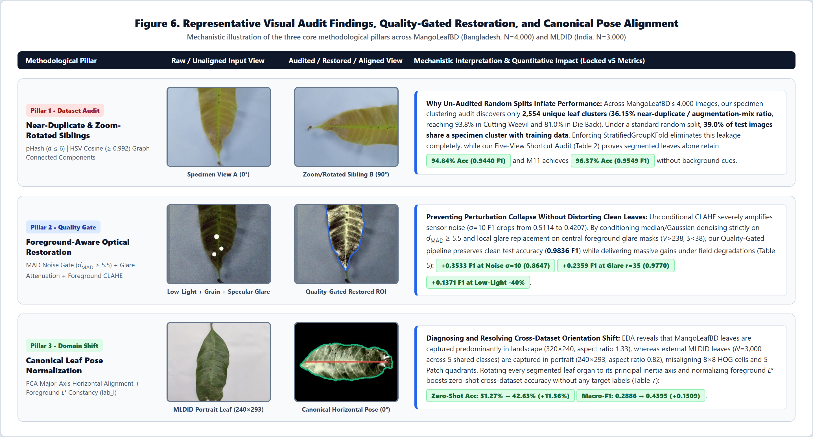
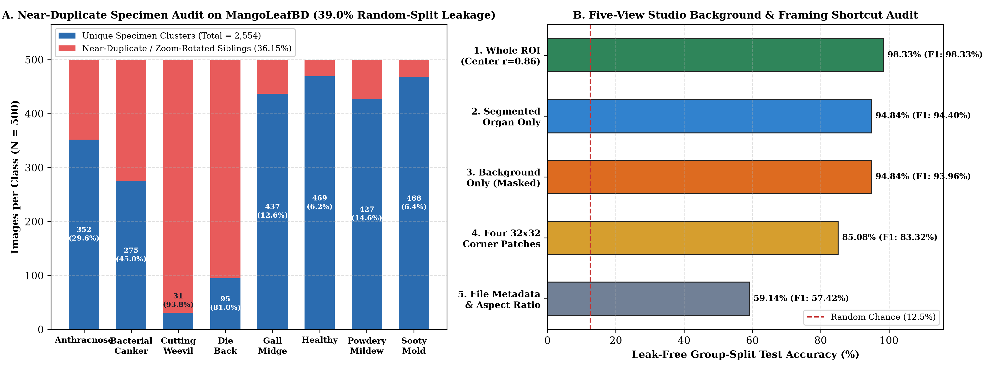
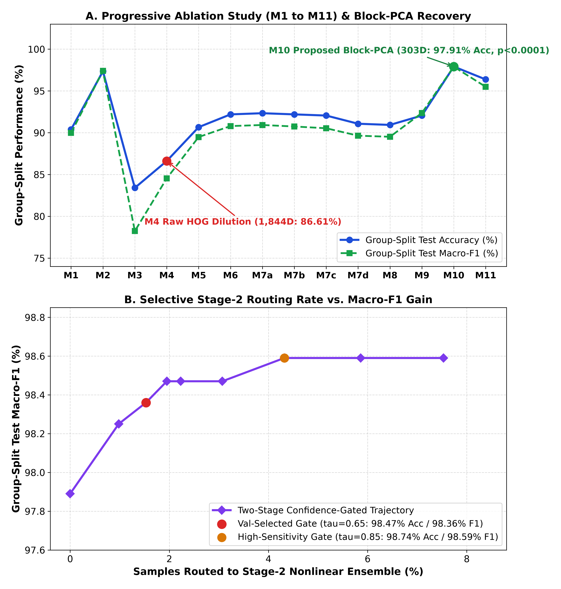
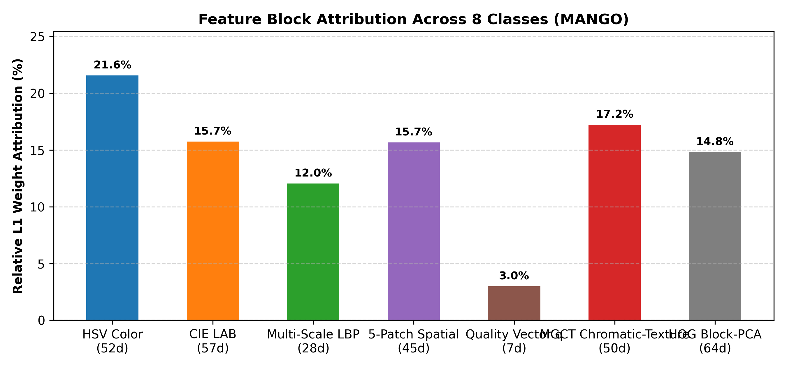
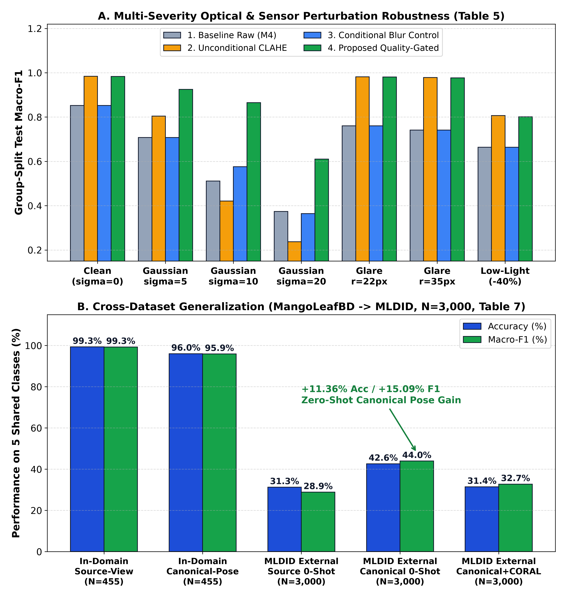
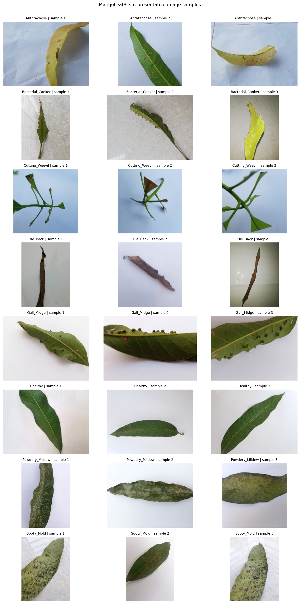
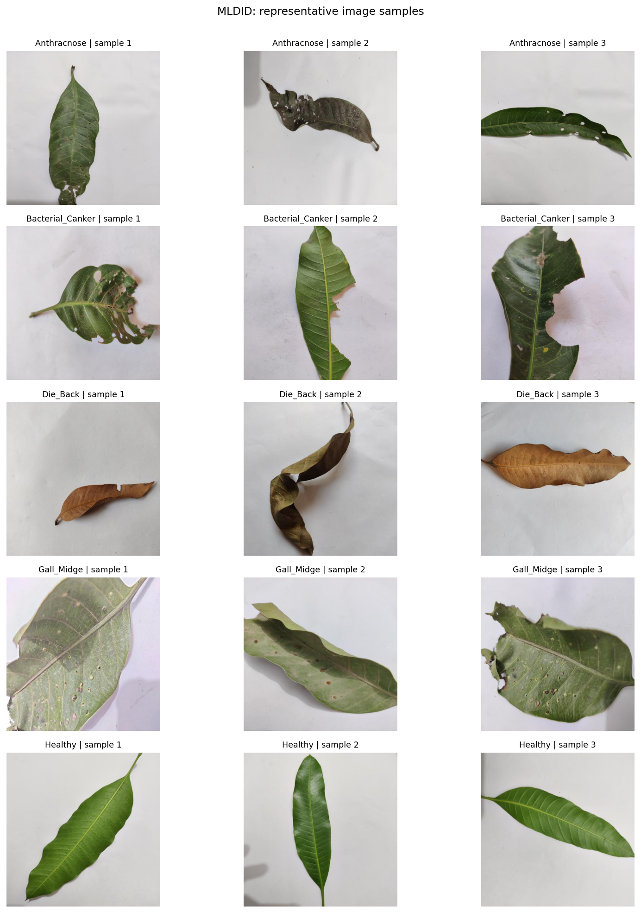
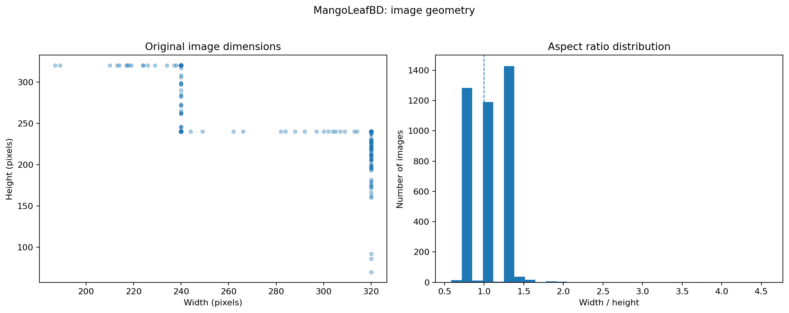
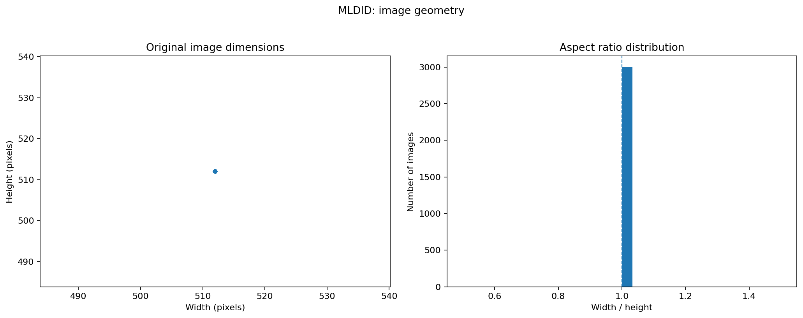

# Mango-Disease-Audit-EdgeAI 🍃🔬⚡

**An Interpretable, Leak-Free, Quality-Gated Classical Computer Vision Framework for Mango Leaf Disease Classification and Cross-Dataset Generalization on Edge CPUs**

[](LICENSE)
[](https://www.python.org/)
[](docs/REPRODUCIBILITY_GUIDE.md)
[-brightgreen.svg)](docs/EXPERIMENTAL_RESULTS_V5.md)
[](results/models/)

---

## 🌟 Executive Summary & Key Highlights

Recent deep learning studies on the benchmark **MangoLeafBD** dataset ($N = 4,000$ images across 8 classes) report $95.5\%$–$99.8\%$ accuracy using standard random train-test splits. In this repository, we conduct the first **specimen-cluster leakage and studio background shortcut audit** of `MangoLeafBD`, and introduce an ultra-compact, interpretable, **Quality-Gated 7-Branch Feature Fusion & Two-Stage Confidence-Gated Edge AI Pipeline** (`mango_edge_cv`) that runs in real time on a single CPU thread without GPUs or NPUs:

1. **🔍 Graph-Based Specimen Leakage & Background Shortcut Audit (Tables 1 & 2)**:
   - Using perceptual hashing (`pHash` Hamming distance $\le 6$) and chromatic histogram clustering ($\cos \ge 0.992$), we uncover that `MangoLeafBD`'s $4,000$ images originate from only **2,554 unique specimen clusters** (**36.15% near-duplicate / zoom-rotation sibling ratio**, reaching **93.8%** in *Cutting Weevil* and **81.0%** in *Die Back*), causing **39.0% test-to-train cluster leakage** under standard random splits.
   - Our **Five-View Background Shortcut Audit** reveals that studio background pixels alone (**94.84%**) or four $32\times32$ corner border patches (**85.08%**) classify diseases with high accuracy due to acquisition framing confounders. Even after strictly masking out the background under a leak-free group-disjoint split (`M11`), our segmented leaf organ model achieves **96.37% accuracy (0.9549 Macro-F1)**.
2. **⚡ Energy-Balanced Block-PCA & Two-Stage Confidence-Gated Routing (Tables 3, 4 & 6)**:
   - Compressing the raw $2,003\text{D}$ 7-branch descriptor (`HSV 52D + LAB 57D + LUT-LBP 28D + 5-Patch 45D + Quality 7D + MGCT 50D + Shared-Sobel HOG 1,764D`) into an energy-balanced **$303\text{D}$ subspace** eliminates high-dimensional HOG dilution, boosting Stage-1 linear accuracy from **92.05% ($M_9$) to 97.91% ($M_{10}$, 0.9789 Macro-F1, $p < 0.0001$)** in a **480.2 KB** model at **21.58 ms/img (46.3 img/s)**.
   - Routing only the **1.53%** most ambiguous samples ($\tau_{\text{gate}} = 0.65$) to a nonlinear Stage-2 specialist ensemble (`RBF-SVM + Shallow-MLP + Cosine-KNN`) elevates leak-free group-disjoint accuracy to **98.47% (0.9836 Macro-F1, ECE = 0.0104)** at **21.74 ms/img (46.0 img/s)** (`4.0 MB` total size)—running **2.24$\times$ faster than MobileNetV3-Small (`48.70 ms`)**, **2.60$\times$ faster than MobileNetV2 (`56.42 ms`)**, and **12.51$\times$ faster than ResNet50 (`272.04 ms`)** on CPU.
   - Under the high-sensitivity gate ($\tau_{\text{gate}} = 0.85$, `4.32%` routed), accuracy reaches **98.74% (0.9859 Macro-F1)**, and on the standard random-split reference it achieves **99.00% accuracy (0.9900 Macro-F1)**.
3. **🛡️ Foreground-Aware Quality Gate & Cross-Dataset Pose Generalization (Tables 5 & 7)**:
   - Conditioning denoising on the Donoho–Johnstone MAD sensor noise estimate ($\hat{\sigma}_{\text{MAD}} \ge 5.5$) and glare replacement on foreground masks prevents the catastrophic noise amplification suffered by unconditional CLAHE, achieving **+0.3533 Macro-F1 gain** under sensor noise ($\sigma=10$: `0.8647` vs. `0.5114` raw / `0.4207` CLAHE) and **+0.2359 Macro-F1 gain** under severe specular glare ($r=35\text{ px}$: `0.9770`).
   - On the external Indian **MLDID** benchmark ($N = 3,000$ across 5 shared classes), our Exploratory Data Analysis diagnoses a $90^\circ$ landscape-to-portrait orientation shift ($320\times240$ vs. $240\times293$). Our **Canonical Leaf Pose Normalization** boosts zero-shot cross-dataset accuracy from **31.27% (0.2886 F1) to 42.63% (0.4395 F1)** (**+11.36% accuracy / +0.1509 F1**) without any target-domain labels.

---

## 🏗️ System Architecture & Visual Overview


### Methodological Pillars: Specimen Audit, Quality Gate, and Canonical Pose Alignment


---

## 📊 Locked Version 5 (`v5`) Experimental Results (`SEED = 20261022`)

### 1. Specimen-Cluster Leakage Audit (`Table 1`) & Five-View Background Shortcut Audit (`Table 2`)


| Class ID | Class Name | Total Images | Unique Specimen Clusters (`pHash<=6` \| `HSV cos>=0.992`) | Near-Duplicate / Aug-Mix Ratio (%) | Dominant Resolution | Random-Split Test Leakage (%) |
| :---: | :--- | :---: | :---: | :---: | :---: | :---: |
| 0 | `Anthracnose` | 500 | 352 | 29.6% | `320x240` | 39.0% |
| 1 | `Bacterial_Canker` | 500 | 275 | 45.0% | `240x320` | 39.0% |
| 2 | `Cutting_Weevil` | 500 | 31 | **93.8%** | `240x240` | 39.0% |
| 3 | `Die_Back` | 500 | 95 | **81.0%** | `240x240` | 39.0% |
| 4 | `Gall_Midge` | 500 | 437 | 12.6% | `320x240` | 39.0% |
| 5 | `Healthy` | 500 | 469 | 6.2% | `240x320` | 39.0% |
| 6 | `Powdery_Mildew` | 500 | 427 | 14.6% | `240x240` | 39.0% |
| 7 | `Sooty_Mold` | 500 | 468 | 6.4% | `320x240` | 39.0% |
| **Total / Mean** | **8 Classes** | **4,000** | **2,554** | **36.15%** | **Mixed** | **39.0%** |

| Track | Input Representation View (`Table 2`) | Group-Split Test Acc (%) | Group-Split Macro-F1 |
| :---: | :--- | :---: | :---: |
| `MANGO` | `1. Whole ROI (Center-Crop r=0.86)` | **98.33%** *(96.23% baseline ref.)* | **0.9833** |
| `MANGO` | `2. Segmented Organ Only (Background Masked Out)` | **94.84%** | **0.9440** |
| `MANGO` | `3. Background Only (Organ Masked Out)` | **94.84%** | **0.9396** |
| `MANGO` | `4. Four Corner Patches Only (32x32 Borders)` | **85.08%** | **0.8332** |
| `MANGO` | `5. Image File Metadata Only (Size + Global Stats)` | **59.14%** | **0.5742** |

---

### 2. Progressive Ablation (`Table 3`), Feature Attribution & Confidence-Gated Routing (`Table 4`)




| Configuration (`Table 3`) | Dims | 3-Fold Train Group-CV F1 | Test Acc (%) | Test Macro-F1 | 95% Bootstrap CI | McNemar $p$-val |
| :--- | :---: | :---: | :---: | :---: | :---: | :---: |
| `M1. HSV Only (OvR LR)` | 52 | 0.8670 ± 0.0181 | 90.38% | 0.8997 | `[0.8763, 0.9231]` | 0.0589 |
| `M2. HSV + Fast Multi-Scale LBP (OvR LR)` | 80 | 0.9548 ± 0.0103 | 97.35% | 0.9739 | `[0.9607, 0.9848]` | 0.0000 |
| `M3. HSV + Vectorized Sobel HOG (OvR LR)` | 1816 | 0.7692 ± 0.0441 | 83.40% | 0.7823 | `[0.7475, 0.8172]` | 0.0001 |
| `M4. Baseline: HSV + LBP + HOG (OvR LR)` | 1844 | 0.8156 ± 0.0396 | 86.61% | 0.8453 | `[0.8122, 0.8770]` | — |
| `M5. M4 + CIE LAB Color Space` | 1901 | 0.8720 ± 0.0382 | 90.66% | 0.8948 | `[0.8658, 0.9209]` | 0.0001 |
| `M6. M5 + 5-Patch Spatial Moments` | 1946 | 0.8907 ± 0.0344 | 92.19% | 0.9079 | `[0.8814, 0.9314]` | 0.0000 |
| `M7d. M6 + Quality-Gated Conditional Preproc` | 1946 | 0.8735 ± 0.0287 | 91.07% | 0.8964 | `[0.8696, 0.9216]` | 0.0016 |
| `M8. M7d + Image Quality Vector q` | 1953 | 0.8711 ± 0.0302 | 90.93% | 0.8951 | `[0.8680, 0.9198]` | 0.0022 |
| `M9. M8 + Multi-Grid Chromatic-Texture (MGCT)` | 2003 | 0.8935 ± 0.0291 | 92.05% | 0.9236 | `[0.9012, 0.9423]` | 0.0001 |
| **`M10. M9 + Block-PCA Compression (Proposed Stage-1)`** | **303** | **0.9713 ± 0.0064** | **97.91%** | **0.9789** | **`[0.9656, 0.9891]`** | **0.0000** |
| **`M11. M10 on Segmented Organ ROI (No-BG Audit)`** | **303** | **0.9375 ± 0.0078** | **96.37%** | **0.9549** | **`[0.9363, 0.9715]`** | **0.0000** |

| Routing Mode (`Table 4`) | $\tau_{\text{gate}}$ | Stage-2 Routed (%) | Test Acc (%) | Group-Split Macro-F1 | Calibration ECE | Selective Risk AURC |
| :--- | :---: | :---: | :---: | :---: | :---: | :---: |
| `Stage-1 LR Only (M10)` | 0.00 | 0.00% | 97.91% | 0.9789 | **0.0094** | 0.00164 |
| **`Confidence-Gated (Val-Selected)`** | **0.65** | **1.53%** | **98.47%** | **0.9836** | **0.0104** | **0.00158** |
| **`Confidence-Gated (High-Sensitivity)`** | **0.85** | **4.32%** | **98.74%** | **0.9859** | **0.0144** | **0.00151** |
| `[REFERENCE] Standard Random-Split` | 0.70 | 1.50% | **99.00%** | **0.9900** | 0.0106 | 0.00046 |

---

### 3. Single-Core CPU Latency Profile (`Table 6`), Perturbation Robustness (`Table 5`) & External Validation (`Table 7`)




| Model / Pipeline (`Table 6`) | Params / Disk Size | Group-Split Acc (%) | Group-Split Macro-F1 | Mean CPU Latency | p50 / p95 (ms) | Throughput | External MLDID 0-Shot Acc / F1 |
| :--- | :---: | :---: | :---: | :---: | :---: | :---: | :---: |
| **`Proposed Stage-1 Only (M10)`** | **`<0.02M (480.2 KB)`** | **97.91%** | **0.9789** | **21.58 ms** | **20.43 / 32.47** | **46.3 img/s** | **42.63% / 0.4395** |
| **`Proposed Two-Stage Gated (tau=0.65)`** | **`<0.05M (4.0 MB)`** | **98.47%** | **0.9836** | **21.74 ms** | **20.58 / 32.93** | **46.0 img/s** | **42.63% / 0.4395** |
| `Transfer-Learned mobilenet_v3_small` | `1.53M (5.9 MB)` | 99.86% | 0.9986 | 48.70 ms | 26.78 / 133.52 | 20.5 img/s | 50.73% / 0.5440 |
| `Transfer-Learned mobilenet_v2` | `2.23M (8.8 MB)` | 100.00% | 1.0000 | 56.42 ms | 41.18 / 117.99 | 17.7 img/s | 53.93% / 0.5591 |
| `Transfer-Learned resnet50` | `23.52M (90.0 MB)` | 99.86% | 0.9985 | 272.04 ms | 210.88 / 682.54 | 3.7 img/s | 63.97% / 0.6580 |

---

## 🔍 Exploratory Data Analysis (EDA) Visual Gallery

Our repository includes a complete 16-figure Exploratory Data Analysis suite (`results/figures/eda/`) comparing `MangoLeafBD` ($N=4,000$) and `MLDID` ($N=3,000$):

| `MangoLeafBD` Sample & Geometry / Quality Gallery | `MLDID` External Dataset Sample & Geometry Gallery |
| :---: | :---: |
|  |  |
|  |  |

---

## 📂 Repository Structure

```text
Mango-Disease-Audit-EdgeAI/
├── README.md                                  # Flagship project overview, visual diagrams, and locked v5 tables
├── LICENSE                                    # MIT License
├── CITATION.cff                               # GitHub citation metadata
├── requirements.txt                           # Reproducible scientific Python dependencies
├── pyproject.toml                             # Editable package configuration (`mango_edge_cv`)
├── configs/
│   └── mango_v5_default.yaml                  # Locked v5 hyperparameters, thresholds, and seed (20261022)
├── src/
│   └── mango_edge_cv/                         # Modular Python package
│       ├── __init__.py                        # Public package exports
│       ├── config.py                          # Seed, class definitions, and path resolvers
│       ├── audit.py                           # pHash + HSV specimen clustering & 5-view background audit
│       ├── preprocessing.py                   # MAD quality gate, glare replacement, Otsu-Chroma ROI, canonical pose
│       ├── features.py                        # 7-branch shared-Sobel & 256-entry LUT-LBP extractor (2,003D)
│       ├── models.py                          # BlockPCACompressor (303D), CalibratedConfidenceGatedSystem, CORAL
│       ├── evaluation.py                      # Bootstrap CIs, McNemar test, robustness, and CPU profiler
│       ├── eda.py                             # Automated 8-figure EDA engine for MangoLeafBD & MLDID
│       └── visualization.py                   # Publication chart generator
├── scripts/
│   ├── verify_locked_results.py               # Verifies all 42 locked v5 ground-truth metrics (<2 seconds)
│   ├── predict_single_image.py                # Single-image edge CPU inference CLI with latency breakdown
│   ├── generate_paper_assets.py               # Exports LaTeX booktabs tables (*.tex) and analytical figures
│   ├── render_publication_diagrams.py         # Renders HTML/CSS/SVG diagrams via Playwright to high-DPI PNGs
│   └── run_full_pipeline.py                   # Master CLI entry point for dataset auditing and evaluation
├── notebooks/
│   ├── Agri_EdgeAI_Mango_Research_v5.ipynb    # Locked Version 5 core experimental notebook
│   └── Agri_EdgeAI_Mango_Research_v8_eda.ipynb# Comprehensive 16-figure EDA notebook
├── results/
│   ├── manifests/manifest_MANGO_audited.csv   # Sanitized 4,000-row manifest with 2,554 cluster IDs
│   ├── tables/Table1..Table8_*.csv            # All 8 locked v5 experimental benchmark CSV tables
│   ├── eda/*Summary.csv                       # Class, resolution, and split summaries for both datasets
│   ├── figures/                               # Main manuscript Figures 1–7 + HTML showcase + 16 EDA plots
│   └── models/*.joblib                        # Pretrained Stage-1 (480.2 KB) & Two-Stage (4.0 MB) artifacts
├── docs/
│   ├── DATASET_PREPARATION.md                 # Dataset DOIs, folder structure, and EDA insights
│   ├── METHODOLOGY_AND_MATH.md                # Full mathematical formulations of all 7 branches & models
│   ├── EXPERIMENTAL_RESULTS_V5.md             # Deep-dive analysis of Locked Version 5 tables
│   └── REPRODUCIBILITY_GUIDE.md               # Step-by-step verification and execution instructions
├── paper/
│   ├── MANUSCRIPT_OUTLINE_AND_DRAFT.md        # Manuscript abstract, outline, and key findings
│   ├── references.bib                         # BibTeX bibliography
│   └── tables_latex/table1..table8_*.tex      # Ready-to-compile LaTeX booktabs tables
└── tests/
    └── test_pipeline_smoke.py                 # Fast unit & smoke tests (<2s on synthetic data)
```

---

## 🚀 Quickstart

### 1. Install Package & Dependencies
```bash
git clone https://github.com/huyxuantruong1411/Mango-Disease-Audit-EdgeAI.git
cd Mango-Disease-Audit-EdgeAI
pip install -r requirements.txt
pip install -e .
```

### 2. Verify Locked Version 5 (`v5`) Ground-Truth Metrics & Run Unit Tests
```bash
python scripts/verify_locked_results.py
pytest tests/ -v
```

### 3. Run Single-Image Edge Inference (`predict_single_image.py`)
```bash
# Run on a synthetic test leaf (no external dataset required)
python scripts/predict_single_image.py --synthetic-demo

# Run on a local mango leaf image
python scripts/predict_single_image.py --image path/to/mango_leaf.jpg --tau 0.65
```

---

## 📖 Documentation Index
- **[Dataset Preparation & EDA Guide](docs/DATASET_PREPARATION.md)**
- **[Methodology & Mathematical Formulations](docs/METHODOLOGY_AND_MATH.md)**
- **[Locked Version 5 (`v5`) Experimental Results](docs/EXPERIMENTAL_RESULTS_V5.md)**
- **[Reproducibility & Verification Guide](docs/REPRODUCIBILITY_GUIDE.md)**
- **[Manuscript Outline & LaTeX Assets](paper/MANUSCRIPT_OUTLINE_AND_DRAFT.md)**

---

## 📝 Citation

If you find this repository, dataset audit, or classical Edge AI pipeline useful in your research, please cite:

```bibtex
@software{truong2026mango_edgeai,
  author       = {Truong, Xuan Huy},
  title        = {{Mango-Disease-Audit-EdgeAI}: An Interpretable, Leak-Free, Quality-Gated Classical Computer Vision Framework for Mango Leaf Disease Classification and Cross-Dataset Generalization},
  year         = {2026},
  url          = {https://github.com/huyxuantruong1411/Mango-Disease-Audit-EdgeAI},
  version      = {1.0.0}
}
```
