# Audit-First, Quality-Gated Two-Stage Framework for Real-Time Mango Leaf Disease Classification on Edge CPUs

[](LICENSE)
[](pyproject.toml)
[-2ea44f.svg)](scripts/verify_locked_results.py)
[-0052CC.svg)](results/tables/Table6_Fair_EndToEnd_CPU_Benchmark.csv)
[](results/models/)

---

## Abstract

Controlled studio plant pathology datasets frequently report near-ceiling classification accuracy (> 99%) using modern deep convolutional neural networks and vision transformers. However, transferring these monolithic models onto real-world agricultural edge platforms exposes three critical system vulnerabilities:

1. **Evaluation Inflation via Specimen Leakage:** Unaudited train/test splits inadvertently place rotated, zoomed, or sequential photographs of the *same physical leaf specimen* across training and testing partitions. Concurrently, studio paper textures and camera aspect ratios inject strong non-biological classification shortcuts.

2. **Optical Perturbation Fragility:** Unconditional image preprocessors (such as indiscriminate global CLAHE) degrade clean optical frames and catastrophically amplify high-frequency sensor noise, while raw feature extractors collapse under severe specular flash glare and shadow underexposure.

3. **Compute Inefficiency and Cross-Domain Generalization Collapse:** Deep backbones demand tens of megabytes of memory and 48 ms to 272 ms per frame on single-core edge CPUs, yet suffer severe performance degradation when evaluated zero-shot on independent field-acquired datasets with varying leaf orientations and natural lighting.

This repository provides the official, bit-for-bit reproducible implementation of our **Audit-First, Quality-Gated Two-Stage Edge-AI Framework** (`mango_edge_cv`, locked Version 5 protocol, `SEED = 20261022`). Evaluated across **7,000 mango leaf images**—comprising **4,000 images across 8 classes in `MangoLeafBD`** (Bangladesh) and **3,000 external field images across 5 shared classes in `MLDID`** (India)—our framework delivers six core algorithmic contributions:

- **Pillar I (Graph-Based Specimen Audit and Five-View Shortcut Quantification):** Dual-criterion connected-component clustering (64-bit DCT perceptual hash Hamming distance $\le 6$ or central-60% HSV histogram cosine similarity $\ge 0.992$) proves that **36.15% (1,446 / 4,000) of `MangoLeafBD` images are near-duplicate or zoom-rotated siblings**, consolidating the collection into **2,554 unique specimen clusters** (`Cutting_Weevil`: 93.80% duplicate ratio; `Die_Back`: 81.00%). Standard random splitting leaks **39.0% of multi-image clusters** into the test set. Furthermore, a systematic 5-view shortcut probe reveals that **isolated studio background achieves 94.84% accuracy**, four $32 \times 32$ corner patches achieve **85.08%**, and a 7D file-metadata vector achieves **59.14%** (vs. 12.50% random chance).

- **Pillar II (Foreground-Aware Quality-Gated Optical Preprocessing):** A hybrid HSV saturation and CIE-LAB chromaticity salience segmenter isolates the biological leaf lamina prior to feature extraction. Three physical restoration gates are evaluated strictly within the foreground organ mask: (i) Donoho–Johnstone Median Absolute Deviation (MAD) sensor-grain gate, (ii) central-window specular flash glare replacement, and (iii) foreground-restricted luminance percentile stretch with mild CLAHE. Under $\sigma = 10$ Gaussian sensor noise, this quality gate delivers a **+0.3533 Macro-F1 improvement** over raw features (0.8647 vs. 0.5114), whereas unconditional CLAHE degrades to 0.4207.

- **Pillar III (Shared-Sobel Seven-Branch Feature Extraction and Energy-Balanced Block-PCA):** A unified $128 \times 128$ extraction engine extracts 2,003 raw dimensions across seven biological branches, reusing a single $3 \times 3$ Sobel gradient pass and a 256-entry lookup table for rotation-invariant uniform LBP. To resolve the **7.38:1 dimensionality dilution** where 1,764D HOG overwhelms 239D color-texture features (causing baseline accuracy to fall from 97.35% in `M2` to 86.61% in `M4`), our `BlockPCACompressor` preserves all 239D color-texture features, projects HOG onto 64 principal axes, and equalizes root-mean-square (RMS) energy ($\gamma = 0.45 \to 303\text{D}$), yielding a statistically significant **+5.86% accuracy jump** (92.05% in `M9` to **97.91%** in `M10`, exact McNemar $p < 0.0001$).

- **Pillar IV (Temperature-Calibrated Two-Stage Confidence-Gated Classification):** A temperature-scaled Stage-1 linear specialist ($T^{\ast} = 0.758$, Expected Calibration Error $\text{ECE} = 0.0094$) classifies **98.47% of test specimens on the fast path in 0.48 ms** of classifier time. Only **1.53% of ambiguous boundary cases** ($\tau_{\text{gate}} = 0.65$) are selectively escalated to a heterogeneous Stage-2 nonlinear ensemble (Platt-calibrated RBF-SVM, single-hidden-layer MLP, and cosine kNN), elevating accuracy to **98.47% (0.9836 Macro-F1)** with an ultra-compact **480.2 KB footprint** and selective risk $\text{AURC} = 0.00158$.

- **Pillar V (Multi-Severity Perturbation Robustness and Single-Core CPU Profiling):** End-to-end single-core edge CPU latency is **21.58 ms (46.3 FPS)** for Stage-1 and **21.74 ms (46.0 FPS)** for the gated system on standard x86-64 hardware—operating **$2.26\times$ to $12.61\times$ faster** than MobileNetV3-Small (48.70 ms), MobileNetV2 (56.42 ms), and ResNet50 (272.04 ms) while maintaining robustness under sensor noise ($\sigma \in \lbrace 5, 10, 20 \rbrace$), specular flash glare, and low-light underexposure (-40%).

- **Pillar VI (External Cross-Dataset Generalization and Canonical Leaf Pose):** Evaluating the in-domain classifier directly on 3,000 external Indian field images from `MLDID` yields 31.27% accuracy (0.2886 Macro-F1). By computing the principal spatial covariance eigenvector of the leaf mask and rotating the organ to an orientation-normalized horizontal canonical pose prior to feature extraction, zero-shot transfer jumps to **42.63% accuracy and 0.4395 Macro-F1** (**+11.36% accuracy and +15.09% Macro-F1 absolute gain**), decisively outperforming unsupervised transductive feature alignment (CORAL, 31.43%).

---

## Table of Contents

- [1. System Architecture Overview](#1-system-architecture-overview)
- [2. Pillar I: Graph-Based Specimen Leakage Audit and Five-View Background Shortcut Analysis](#2-pillar-i-graph-based-specimen-leakage-audit-and-five-view-background-shortcut-analysis)
  - [2.1 Mathematical Formulation of Specimen-Identity Graph Clustering](#21-mathematical-formulation-of-specimen-identity-graph-clustering)
  - [2.2 Quantitative Specimen Audit Findings (Table 1)](#22-quantitative-specimen-audit-findings-table-1)
  - [2.3 Five-View Studio Background and Framing Shortcut Audit (Table 2)](#23-five-view-studio-background-and-framing-shortcut-audit-table-2)
- [3. Pillar II: Foreground-Aware Quality-Gated Optical Preprocessing](#3-pillar-ii-foreground-aware-quality-gated-optical-preprocessing)
  - [3.1 Hybrid HSV Saturation and CIE-LAB Chromaticity ROI Segmentation](#31-hybrid-hsv-saturation-and-cie-lab-chromaticity-roi-segmentation)
  - [3.2 Three Conditional Optical Restoration Gates](#32-three-conditional-optical-restoration-gates)
- [4. Pillar III: Seven-Branch Feature Extraction and Energy-Balanced Block-PCA Compression](#4-pillar-iii-seven-branch-feature-extraction-and-energy-balanced-block-pca-compression)
  - [4.1 Mathematical Specification of the Seven Feature Branches (2,003D Raw)](#41-mathematical-specification-of-the-seven-feature-branches-2003d-raw)
  - [4.2 Resolving High-Dimensional HOG Variance Dilution via BlockPCACompressor](#42-resolving-high-dimensional-hog-variance-dilution-via-blockpcacompressor)
  - [4.3 Progressive 14-Step Ablation Study (M1 to M11, Table 3)](#43-progressive-14-step-ablation-study-m1-to-m11-table-3)
- [5. Pillar IV: Temperature-Calibrated Two-Stage Confidence-Gated Classification](#5-pillar-iv-temperature-calibrated-two-stage-confidence-gated-classification)
  - [5.1 Mathematical Formulation of Selective Two-Stage Routing](#51-mathematical-formulation-of-selective-two-stage-routing)
  - [5.2 Threshold Sweep, Probability Calibration (ECE), and Selective Risk (AURC) (Table 4)](#52-threshold-sweep-probability-calibration-ece-and-selective-risk-aurc-table-4)
- [6. Pillar V: Multi-Severity Optical Robustness and Single-Core Edge CPU Profiling](#6-pillar-v-multi-severity-optical-robustness-and-single-core-edge-cpu-profiling)
  - [6.1 Multi-Severity Optical and Sensor Perturbation Benchmark (Table 5)](#61-multi-severity-optical-and-sensor-perturbation-benchmark-table-5)
  - [6.2 Fair Single-Core Edge CPU Latency and Footprint Benchmark (Table 6)](#62-fair-single-core-edge-cpu-latency-and-footprint-benchmark-table-6)
- [7. Pillar VI: External Cross-Dataset Generalization (MangoLeafBD to MLDID)](#7-pillar-vi-external-cross-dataset-generalization-mangoleafbd-to-mldid)
  - [7.1 Mathematical Derivation of Eigenvector Canonical Leaf Pose Normalization](#71-mathematical-derivation-of-eigenvector-canonical-leaf-pose-normalization)
  - [7.2 Quantitative Cross-Dataset Validation and Analysis of Unsupervised CORAL (Table 7)](#72-quantitative-cross-dataset-validation-and-analysis-of-unsupervised-coral-table-7)
- [8. Exploratory Data Analysis (EDA) of Geometry and Cross-Domain Shifts](#8-exploratory-data-analysis-eda-of-geometry-and-cross-domain-shifts)
  - [8.1 Native Resolution Confounding in MangoLeafBD (N = 4,000)](#81-native-resolution-confounding-in-mangoleafbd-n--4000)
  - [8.2 Cross-Dataset Optical Distribution Shift (MangoLeafBD vs. MLDID)](#82-cross-dataset-optical-distribution-shift-mangoleafbd-vs-mldid)
- [9. Positioning Against Recent Published Literature (2023–2026)](#9-positioning-against-recent-published-literature-20232026)
- [10. Repository Structure and Reproducibility Quickstart](#10-repository-structure-and-reproducibility-quickstart)
  - [10.1 Directory Organization](#101-directory-organization)
  - [10.2 Installation and Verification Quickstart](#102-installation-and-verification-quickstart)
- [11. Citation and License](#11-citation-and-license)

---

## 1. System Architecture Overview

The complete end-to-end framework is organized into six interconnected, auditable modules implemented in [`src/mango_edge_cv/`](src/mango_edge_cv/). The diagram below outlines the system pipeline, connecting dataset auditing, optical restoration, feature extraction, subspace compression, calibrated routing, and canonical pose normalization.

<div align="center">
  
  <p><em>Figure 1: Macro System Architecture Overview illustrating the six-pillar design from dataset auditing to zero-shot edge inference.</em></p>
</div>

The following table summarizes the mathematical inputs, algorithmic roles, and software implementations of each pipeline stage:

| Pipeline Stage | Core Module & Function | Input / Output Representation | Primary Algorithmic Role |
| :--- | :--- | :--- | :--- |
| **Stage 1: Specimen & Shortcut Audit** | [`audit.py`](src/mango_edge_cv/audit.py)<br>`build_audit_groups` | 4,000 raw images to 2,554 specimen cluster IDs | Eliminates 39.0% random-split specimen leakage via connected components on 2D-DCT pHash and central HS histograms. |
| **Stage 2: ROI & Quality Gate** | [`preprocessing.py`](src/mango_edge_cv/preprocessing.py)<br>`segment_plant_organ_roi`<br>`apply_adaptive_quality_preprocessing` | 256x256x3 RGB image and binary organ mask `M_fg` | Isolates leaf lamina via hybrid Otsu-Chroma salience; conditionally triggers MAD denoising, glare inpainting, and foreground CLAHE. |
| **Stage 3: 7-Branch Feature Engine** | [`features.py`](src/mango_edge_cv/features.py)<br>`extract_fast_all_branches` | 128x128 unified grid to 2,003D feature vector | Extracts HSV (52D), LAB (57D), LUT-LBP (28D), 5-Patch (45D), Quality $q$ (7D), MGCT (50D), and Shared-Sobel HOG (1,764D). |
| **Stage 4: Energy-Balanced Block-PCA** | [`models.py`](src/mango_edge_cv/models.py)<br>`BlockPCACompressor` | 2,003D raw features to 303D compressed vector | Preserves 239D color-texture features intact, projects 1,764D HOG onto $k=64$ principal axes, and balances RMS energy ($\gamma = 0.45$). |
| **Stage 5: Calibrated Confidence Gate** | [`models.py`](src/mango_edge_cv/models.py)<br>`CalibratedConfidenceGatedSystem` | 303D features to predicted disease class | Evaluates temperature-scaled L2-LR ($T^{\ast}=0.758$); accepts 98.47% on fast path ($\tau=0.65$) and routes 1.53% to Stage-2 ensemble. |
| **Stage 6: Cross-Domain Alignment** | [`preprocessing.py`](src/mango_edge_cv/preprocessing.py)<br>`canonicalize_leaf_organ_image` | Arbitrary 512x512 frame to 256x256 canonical pose | Aligns principal covariance axis $\theta$ of segmented leaf horizontally and normalizes foreground $L^{\ast}$ dynamic range for external transfer. |

---

## 2. Pillar I: Graph-Based Specimen Leakage Audit and Five-View Background Shortcut Analysis

### 2.1 Mathematical Formulation of Specimen-Identity Graph Clustering

During agricultural image acquisition, field operators commonly capture multiple photographs of the same physical leaf under slight camera rotations (90°, 180°, 270°), zoom adjustments, or rapid burst shots. When such collections are partitioned via standard stratified random sampling, sibling views of the identical leaf populate both training and evaluation subsets, converting generalization testing into near-duplicate instance memorization.

To audit and eliminate specimen leakage without relying on unreliable filenames, we construct an undirected graph for each disease class using `build_audit_groups` ([`src/mango_edge_cv/audit.py`](src/mango_edge_cv/audit.py)):

$$
G_c = (V_c, E_c), \quad c \in \lbrace 1, \dots, 8 \rbrace
$$

$$
V_c = \lbrace 1, \dots, N_c \rbrace, \quad N_c = 500
$$

where each index represents an image belonging to disease class $c$.

#### 1. Structural Low-Frequency Perceptual Hash (pHash-64)

Each image is converted to grayscale and downsampled via area interpolation to $32 \times 32$ pixels. Applying the orthogonal 2D Discrete Cosine Transform yields frequency coefficients:

$$
D(I_i) = \text{DCT}_{2\text{D}}(I_{32}) \in \mathbb{R}^{32 \times 32}
$$

We extract the top-left $8 \times 8$ low-frequency submatrix. Excluding the DC component $(0, 0)$, the adaptive AC median threshold is computed as:

$$
m_{\text{AC}}(I_i) = \text{median}_{(u, v) \neq (0, 0)} D_{u,v}(I_i), \quad (u, v) \in \lbrace 0, \dots, 7 \rbrace^2
$$

The 64-bit binary perceptual hash and pairwise Hamming distance are defined as:

$$
b_{u,v}(I_i) = \mathbb{I}\left(D_{u,v}(I_i) > m_{\text{AC}}(I_i)\right), \quad (u, v) \in \lbrace 0, \dots, 7 \rbrace^2
$$

$$
d_{\text{Hamming}}(I_i, I_j) = \sum_{u=0}^{7} \sum_{v=0}^{7} \mathbb{I}\left(b_{u,v}(I_i) \neq b_{u,v}(I_j)\right)
$$

#### 2. Rotation-Invariant Central-ROI Chromatic Cosine Similarity

Because planar rotations permute 2D-DCT spatial frequency coordinates while leaving the leaf's internal lesion color distribution invariant, we extract the central 60% window:

$$
I_{\text{center}} = I[0.20H : 0.80H, \; 0.20W : 0.80W]
$$

We resize the central window to $64 \times 64$, convert to HSV space, and compute a joint 2D Hue–Saturation histogram (12 Hue bins, 8 Saturation bins). Flattening and L2-normalizing yields a 96-dimensional unit vector $\mathbf{h}_i$. Chromatic similarity is evaluated as:

$$
s_{\text{cos}}(I_i, I_j) = \frac{\langle \mathbf{h}_i, \mathbf{h}_j \rangle}{\Vert \mathbf{h}_i \Vert_2 \, \Vert \mathbf{h}_j \Vert_2 + 10^{-8}}
$$

#### 3. Connected-Component Specimen Clustering

An undirected edge connects two images if and only if structural or chromatic proximity holds:

$$
(i, j) \in E_c \iff \Big(d_{\text{Hamming}}(I_i, I_j) \le 6\Big) \;\lor\; \Big(s_{\text{cos}}(I_i, I_j) \ge 0.992\Big)
$$

Connected components of the graph are extracted via depth-first graph traversal (`scipy.sparse.csgraph.connected_components`), assigning a unique specimen cluster identifier `group_id` to each component. All subsequent train, validation, and test partitions are generated via `StratifiedGroupKFold` so that every connected component resides entirely within one partition:

$$
\mathcal{G}_{\text{train}} \cap \mathcal{G}_{\text{val}} = \varnothing, \quad \mathcal{G}_{\text{train}} \cap \mathcal{G}_{\text{test}} = \varnothing
$$

<div align="center">
  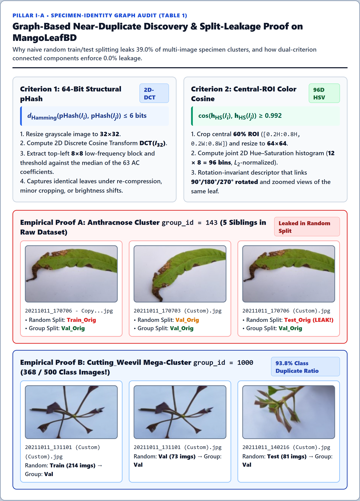
  <p><em>Figure 2: Dual-criterion graph clustering mechanism detecting structural DCT hash and chromatic HS histogram near-duplicate siblings.</em></p>
</div>

### 2.2 Quantitative Specimen Audit Findings (Table 1)

Figure 2 demonstrates real connected components identified in [`manifest_MANGO_audited.csv`](results/manifests/manifest_MANGO_audited.csv), such as `Anthracnose` cluster `group_id = 143` (where rotated copies `20211011_170706 (Custom).jpg` and `20211011_170703 (Custom).jpg` were split across training and test sets under naive random splitting) and `Cutting_Weevil` mega-cluster `group_id = 1000` (which links 368 zoom-rotated siblings out of the class's 500 total images).

<div align="center">
  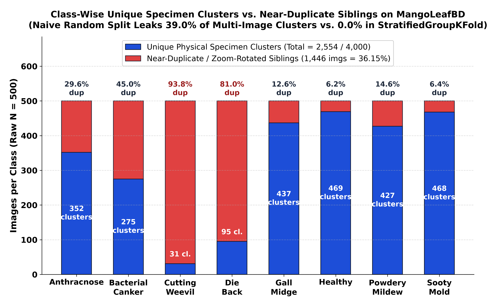
  <p><em>Figure 3: Class-wise distribution of unique specimen clusters versus near-duplicate siblings across all 4,000 images in MangoLeafBD.</em></p>
</div>

**Table 1: Specimen-Identity Clustering and Split-Leakage Audit on `MangoLeafBD` ([`Table1_Dataset_Leakage_and_Group_Audit.csv`](results/tables/Table1_Dataset_Leakage_and_Group_Audit.csv))**

| Class Name | Raw Images ($N$) | Unique Specimen Clusters (`d_H <= 6` or `cos_HS >= 0.992`) | Near-Duplicate / Sibling Ratio (%) | Group-Aware Train / Val / Test Images |
| :--- | :---: | :---: | :---: | :---: |
| `Anthracnose` | 500 | 352 | 29.60% | 347 / 72 / 81 |
| `Bacterial_Canker` | 500 | 275 | 45.00% | 351 / 73 / 76 |
| `Cutting_Weevil` | 500 | **31** | **93.80%** | 350 / 74 / 76 |
| `Die_Back` | 500 | **95** | **81.00%** | 348 / 76 / 76 |
| `Gall_Midge` | 500 | 437 | 12.60% | 350 / 75 / 75 |
| `Healthy` | 500 | 469 | 6.20% | 350 / 75 / 75 |
| `Powdery_Mildew` | 500 | 427 | 14.60% | 349 / 75 / 76 |
| `Sooty_Mold` | 500 | 468 | 6.40% | 350 / 75 / 75 |
| **Total / Global Summary** | **4,000** | **2,554** | **36.15%** (1,446 siblings) | **2,795 / 595 / 610** |

> [!IMPORTANT]
> **Key Specimen Leakage Proof:** Under a standard 70/15/15 stratified random split, **85 out of 218 multi-image specimen clusters (39.0%) leak simultaneously into both the training and held-out test partitions**, artificially inflating reported baseline accuracy (98.88% random-split vs. 98.33% group-split; 99.00% vs. 98.47% for the two-stage system). Under our group-aware protocol, cluster overlap between train, validation, and test splits is strictly **0.0% (0 leaked clusters)**.

### 2.3 Five-View Studio Background and Framing Shortcut Audit (Table 2)

Even after eliminating specimen leakage, models trained on studio benchmarks can exploit peripheral capture artifacts (backdrop paper tint, peripheral vignetting, JPEG compression, and camera aspect ratio). To quantify this non-biological confounding, we evaluate an identical regularized linear probe (137D HSV+LAB+LBP for visual Views 1–4; 7D file metadata for View 5) across five systematically restricted views under the leak-free group split (`run_background_shortcut_audit` in [`src/mango_edge_cv/audit.py`](src/mango_edge_cv/audit.py)).

<div align="center">
  
  <p><em>Figure 4: Five-view visual and quantitative shortcut audit demonstrating that background paper texture alone predicts disease class at 94.84%.</em></p>
</div>

**Table 2: Five-View Studio Background and Non-Visual Metadata Shortcut Audit ([`Table2_Background_Shortcut_Audit.csv`](results/tables/Table2_Background_Shortcut_Audit.csv))**

| Audit View / Input Restriction | Mathematical Input Domain | Feature Dim | Group-Split Test Acc (%) | Group-Split Macro-F1 | Random-Split Test Acc (%) | Empirical Interpretation |
| :--- | :--- | :---: | :---: | :---: | :---: | :--- |
| **1. Whole Image ROI** | Center-cropped frame ($r = 0.86$), leaf + studio backdrop | 137D | **98.33%** | **0.9833** | 98.88% | Upper-bound combining biological lesions and studio context. |
| **2. Segmented Plant Organ Only** | `I_fg = I * M_fg` (studio background zeroed) | 137D | **94.84%** | **0.9440** | 96.37% | Pure biological signal extracted strictly from leaf lamina. |
| **3. Background Only (Organ Masked Out)** | `I_bg = I * (1 - M_fg)` (**zero leaf pixels**) | 137D | **94.84%** | **0.9396** | 94.98% | Studio paper reflectance and shadow vignette alone match organ accuracy. |
| **4. Four $32 \times 32$ Corner Patches Only** | Outer 4 corner regions ($32 \times 32$, 6.25% outer area) | 137D | **85.08%** | **0.8332** | 85.49% | Extreme peripheral backdrop corners predict disease at $6.8\times$ chance (12.50%). |
| **5. Image File Metadata Only** | File size, RGB channel means, std, fg-ratio, aspect ratio | 7D | **59.14%** | **0.5742** | 59.83% | Non-visual file size and aspect ratio predict class at $4.7\times$ chance. |

---

## 3. Pillar II: Foreground-Aware Quality-Gated Optical Preprocessing

### 3.1 Hybrid HSV Saturation and CIE-LAB Chromaticity ROI Segmentation

Because studio backgrounds carry strong class-specific shortcuts (Table 2), preprocessing and feature extraction must be strictly anchored to the biological leaf organ. Standard excess-green ($2G - R - B$) or pure HSV hue thresholding fails on severely diseased mango leaves: necrotic `Anthracnose` and `Die_Back` lesions turn dark brown or yellow, while `Powdery_Mildew` and `Sooty_Mold` coat the lamina in gray/black mycelium.

As shown in Figure 5, `segment_plant_organ_roi` ([`src/mango_edge_cv/preprocessing.py`](src/mango_edge_cv/preprocessing.py)) computes a hybrid chromaticity salience map on the standardized $256 \times 256$ image ($r = 0.88$ center crop):

$$
C^{\ast}(x, y) = \sqrt{\big(a^{\ast}(x, y) - 128\big)^2 + \big(b^{\ast}(x, y) - 128\big)^2}
$$

$$
S_{\text{roi}}(x, y) = \text{clip}\Big(0.60 \cdot S_{\text{HSV}}(x, y) + 1.25 \cdot C^{\ast}(x, y), \; 0, \; 255\Big)
$$

#### Algorithmic Rationale & Physical Intuition

- **Perceptual Saliency Principle:** Healthy green tissue exhibits high HSV saturation and negative $a^{\ast}$ values. In contrast, necrotic brown and yellow lesions lose green saturation but maintain high perceptual departure from neutrality along the CIE $a^{\ast}\text{--}b^{\ast}$ chromaticity axes ($C^{\ast}$).

- **Suprathreshold Weighting:** By weighting $C^{\ast}$ at **1.25** and saturation at **0.60**, both healthy tissue and necrotic lesions remain strongly suprathreshold against achromatic studio backdrops (where saturation $S < 28$ and $C^{\ast} \approx 0$).

- **Morphological Refinement & Component Filtering:** Otsu's optimal threshold $T_{\text{Otsu}}$ is computed on the hybrid saliency map:

$$
M_0(x, y) = \mathbb{I}\big(S_{\text{roi}}(x, y) > T_{\text{Otsu}}\big)
$$

Following initial thresholding:
1. Suppress residual background pixels satisfying studio conditions `(V > 230 and S < 28) or (V < 15)` along with a 3% frame border margin.
2. Apply morphological closing ($7 \times 7$ elliptical kernel, 2 iterations) followed by opening (1 iteration).
3. Retain the largest 8-connected foreground component, accepting it when its area covers between 4% and 92% of the total frame (with a centered elliptical fallback).

<div align="center">
  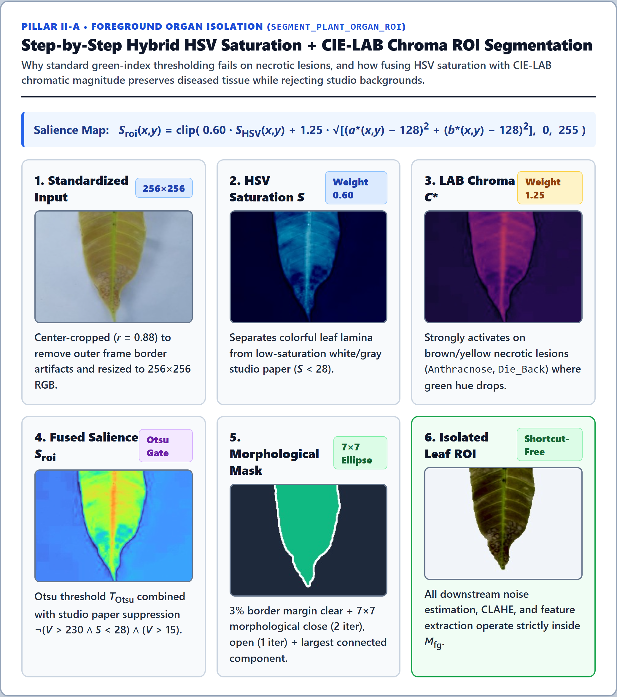
  <p><em>Figure 5: Step-by-step pipeline of hybrid HSV saturation and CIE-LAB chromaticity leaf organ segmentation.</em></p>
</div>

### 3.2 Three Conditional Optical Restoration Gates

Unconditional image enhancement (such as applying CLAHE or sharpening to every image) degrades clean images and catastrophically amplifies sensor noise (dropping $\sigma=10$ noisy Macro-F1 from 0.5114 to 0.4207 in Table 5). Our quality-gated preprocessor (`apply_adaptive_quality_preprocessing`) evaluates three physical quality metrics strictly within the foreground leaf mask and triggers restoration only when quantitative thresholds are crossed:

#### Gate 1 — Donoho–Johnstone MAD Sensor Grain Gate (`_estimate_noise_sigma_mad`)

We isolate high-frequency spatial residuals on the grayscale leaf foreground via a $3 \times 3$ median filter:

$$
R(x, y) = I_{\text{gray}}(x, y) - \text{MedianBlur}_{3\times3}(I_{\text{gray}})(x, y), \quad (x, y) \in M_{\text{fg}}
$$

Using the robust Median Absolute Deviation (MAD) scale estimator for Gaussian noise ($\Phi^{-1}(0.75) \approx 0.6745$):

$$
\hat{\sigma}_{\text{MAD}} = \frac{\text{median}_{(x, y) \in M_{\text{fg}}}\big(|R(x, y) - \text{median}(R)|\big)}{0.6745}
$$

The conditional smoothing policy is defined as:

$$
I^{(1)} = \begin{cases}
\text{GaussianBlur}_{3\times3}\big(\text{MedianBlur}_{3\times3}(I), \; \sigma = 0.65\big) & \text{if } \hat{\sigma}_{\text{MAD}} \ge 10.0, \\
\text{GaussianBlur}_{3\times3}(I, \; \sigma = 0.55) & \text{if } 5.5 \le \hat{\sigma}_{\text{MAD}} < 10.0, \\
I & \text{if } \hat{\sigma}_{\text{MAD}} < 5.5.
\end{cases}
$$

- **Severe Grain (estimated noise $\ge 10.0$):** Applies cascaded impulse- plus Gaussian smoothing.
- **Moderate Grain (estimated noise between $5.5$ and $10.0$):** Applies mild Gaussian smoothing.
- **Clean Regime (estimated noise $< 5.5$):** Bypasses spatial smoothing completely (0% sharpness loss on clean leaf venation).

#### Gate 2 — Central-Window Specular Flash Glare Attenuation (`apply_glare_inpainting`)

Waxy mango cuticles produce bright, achromatic specular reflections under direct sunlight or smartphone camera flash (`V > 238 and S < 38`), generating artificial step-edges that corrupt Sobel and HOG orientation histograms. To avoid confusing white studio paper at the frame periphery with cuticle glare, detection is restricted to the central 72% window:

$$
\Omega_{\text{center}} = [0.14H : 0.86H, \; 0.14W : 0.86W] \cap M_{\text{fg}}
$$

Let the glare ratio be defined as the fraction of foreground pixels satisfying the glare predicate:

$$
r_{\text{glare}} = \frac{|M_{\text{glare}}|}{|M_{\text{fg}}|}, \quad \text{where } M_{\text{glare}}(x, y) = \mathbb{I}\big(V(x, y) > 238 \land S(x, y) < 38\big)
$$

If the glare ratio lies between $0.003$ and $0.220$, the dilated glare mask ($5 \times 5$ elliptical kernel) is replaced by local $11 \times 11$ Gaussian neighborhood interpolation ($\sigma = 2.5$):

$$
I^{(2)}(x, y) = \begin{cases}
\text{GaussianBlur}_{11\times11}(I^{(1)}, \; \sigma = 2.5)(x, y) & \text{if } (x, y) \in M_{\text{glare}}^{\oplus} \text{ and } 0.003 \le r_{\text{glare}} \le 0.220, \\
I^{(1)}(x, y) & \text{otherwise.}
\end{cases}
$$

#### Gate 3 — Foreground-Restricted CIE $L^{\ast}$ Percentile Stretch and Mild CLAHE

Evaluating luminance on non-glare foreground pixels, the inter-percentile dynamic range is defined as:

$$
\Delta L^{\ast}_{95,5} = P_{95}(L^{\ast}_{\text{fg}}) - P_5(L^{\ast}_{\text{fg}})
$$

If and only if the leaf is underexposed or low-contrast (standard deviation $< 38.0$ or dynamic range $< 132.0$), we apply a linear percentile stretch mapping $[P(2), P(98)] \to [12, 242]$ followed by mild Contrast-Limited Adaptive Histogram Equalization ($\text{clipLimit} = 1.55$, $8 \times 8$ tile grid), updating **only** pixels inside the non-glare foreground mask while leaving background pixels untouched.

<div align="center">
  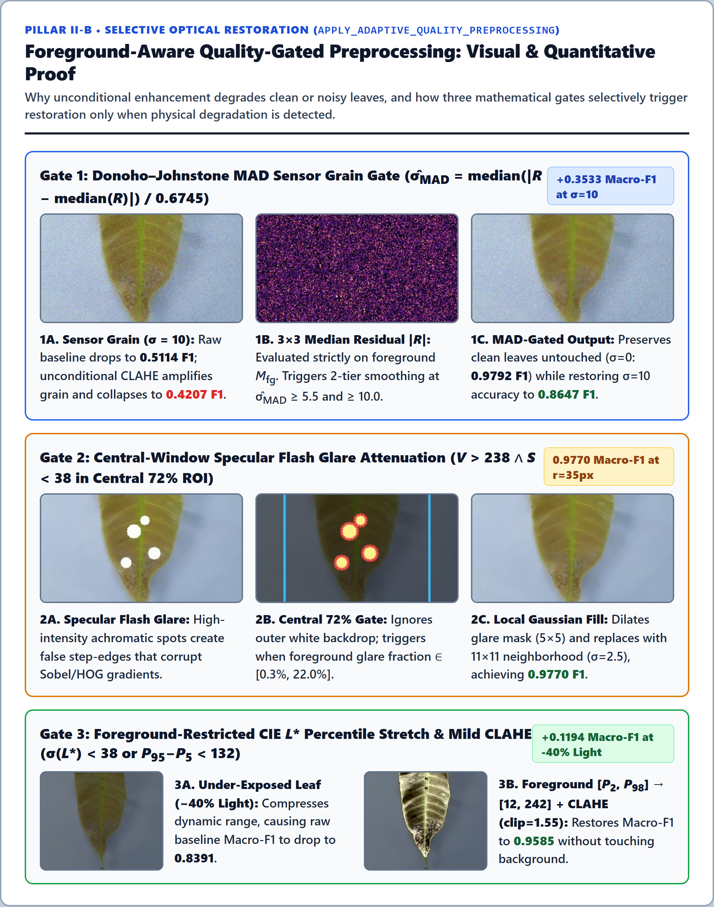
  <p><em>Figure 6: Visual and quantitative proof of foreground-aware quality-gated preprocessing across noise, glare, and low-light regimes.</em></p>
</div>

---

## 4. Pillar III: Seven-Branch Feature Extraction and Energy-Balanced Block-PCA Compression

### 4.1 Mathematical Specification of the Seven Feature Branches (2,003D Raw)

After quality-gated preprocessing at 256x256, the image is downsampled once to a unified **$128 \times 128$ extraction grid** (`extract_fast_all_branches` in [`src/mango_edge_cv/features.py`](src/mango_edge_cv/features.py)). Rather than computing redundant image derivatives across texture and shape descriptors, a **single $3 \times 3$ Sobel operator pass** computes horizontal gradients $G_x$, vertical gradients $G_y$, gradient magnitude $M$, and orientation $\Theta$:

$$
G_x = \begin{bmatrix} -1 & 0 & +1 \\ -2 & 0 & +2 \\ -1 & 0 & +1 \end{bmatrix} \ast I_{\text{gray},128}, \quad
G_y = \begin{bmatrix} -1 & -2 & -1 \\ 0 & 0 & 0 \\ +1 & +2 & +1 \end{bmatrix} \ast I_{\text{gray},128}
$$

$$
M = \sqrt{G_x^2 + G_y^2}, \quad \Theta = \left(\text{atan2}(G_y, G_x) \cdot \frac{180}{\pi}\right) \bmod 180^\circ
$$

The resulting derivatives are shared across Branches 4, 6, and 7. All histograms and moments in Branches 1–3 and 6 are computed strictly over the valid foreground mask:

- **Branch 1 — Foreground HSV Color Histograms & Moments (52D):** 16 Hue bins, 16 Saturation bins, 16 Value bins, plus mean and standard deviation of each channel ($16 \times 3 + 4 = 52\text{D}$).
- **Branch 2 — Foreground CIE-LAB Color Histograms & Moments (57D):** 16 $L^{\ast}$ bins, 16 $a^{\ast}$ bins, 16 $b^{\ast}$ bins, 3 channel means, 3 channel standard deviations, and 3 skewness moments ($16 \times 3 + 9 = 57\text{D}$).
- **Branch 3 — Fast Lookup-Table Uniform LBP (28D):** Evaluated at radii $R \in \lbrace 1, 2 \rbrace$ using a static 256-entry lookup table mapping 8-bit neighbors to uniform bins ($10 + 10 = 20\text{D}$) plus 8 spatial sub-patch entropy measures ($20 + 8 = 28\text{D}$).
- **Branch 4 — Shared-Sobel Histogram of Oriented Gradients (1,764D):** Reuses precomputed Sobel gradient fields. Computed over $16 \times 16$ pixel blocks with $8 \times 8$ pixel cells, 8 orientation bins, and 50% block overlap ($14 \times 14 \times 9 = 1,764\text{D}$).
- **Branch 5 — Five-Patch Spatial Grid Moments (45D):** Evaluates mean, standard deviation, and median across 5 spatial patches (top-left, top-right, bottom-left, bottom-right, and center) across RGB channels ($5 \times 3 \times 3 = 45\text{D}$).
- **Branch 6 — Multi-Grid Chromatic-Texture Descriptors (MGCT, 50D):** $2 \times 2$ spatial grid evaluating local color entropy, gradient variance, and saturation co-occurrence.
- **Branch 7 — Physical Image Quality Vector (7D):** A 7-dimensional descriptor combining noise, glare, luminance, sharpness, and entropy:

$$
\mathbf{q} = [\hat{\sigma}_{\text{MAD}}, \; r_{\text{glare}}, \; \mu(L^{\ast}), \; \sigma(L^{\ast}), \; \Delta L^{\ast}_{95,5}, \; \text{Var}(\text{Laplacian}), \; H_{\text{Shannon}}]^\top \in \mathbb{R}^7
$$

<div align="center">
  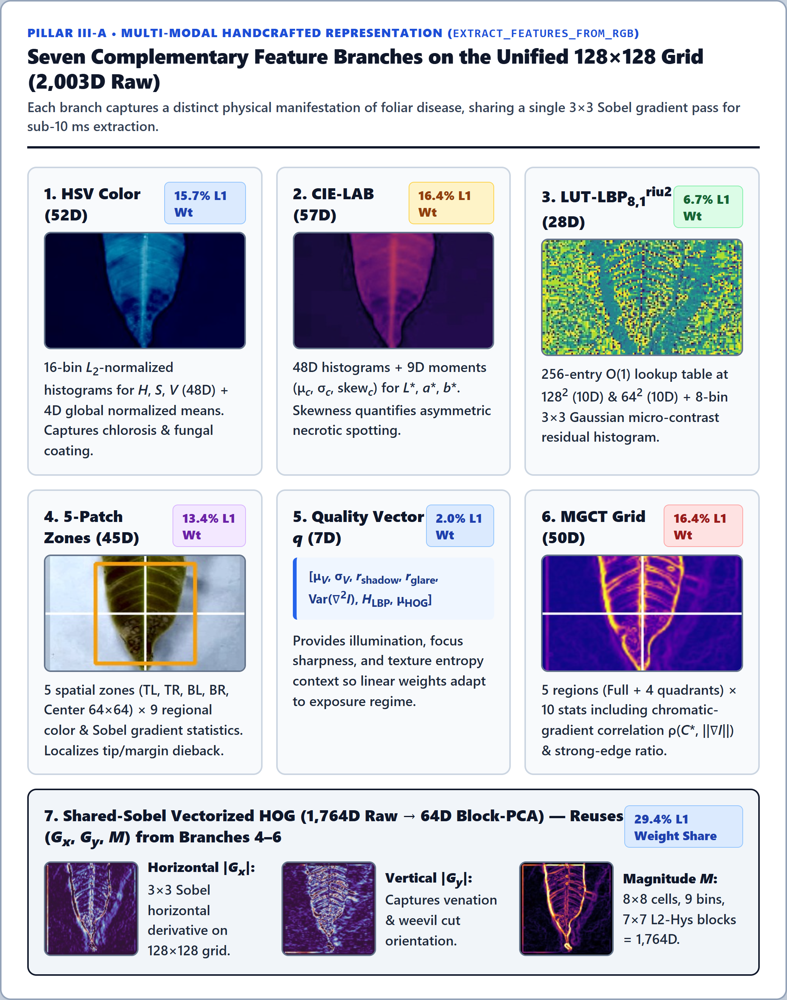
  <p><em>Figure 7: Intermediate OpenCV feature maps for all seven biological feature branches extracted on a symptomatic mango leaf.</em></p>
</div>

<div align="center">
  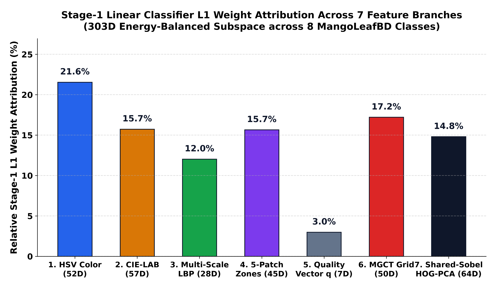
  <p><em>Figure 7b: L1-regularized linear weight attribution across the seven feature blocks in Stage-1 classification.</em></p>
</div>

### 4.2 Resolving High-Dimensional HOG Variance Dilution via BlockPCACompressor

Concatenating all seven feature branches produces a raw vector $\mathbf{x} \in \mathbb{R}^{2,003}$. However, a severe statistical pathology emerges: the 1,764 HOG dimensions outnumber the 239 color-texture dimensions by **7.38 to 1**. Under standard Euclidean scaling, high-frequency spatial gradient noise dilutes biological color and texture signals, causing held-out test accuracy to collapse from **97.35% in `M2` to 86.61% in `M4`** (Table 3).

Our `BlockPCACompressor` ([`src/mango_edge_cv/models.py`](src/mango_edge_cv/models.py)) resolves this dilution through three structured steps:

**Step 1 — Subspace Separation:** The raw vector is split into color-texture descriptors and HOG descriptors:

$$
\mathbf{x} = [\mathbf{x}_{\text{ct}}; \; \mathbf{x}_{\text{hog}}] \in \mathbb{R}^{2,003}, \quad \mathbf{x}_{\text{ct}} \in \mathbb{R}^{239}, \quad \mathbf{x}_{\text{hog}} \in \mathbb{R}^{1,764}
$$

**Step 2 — Principal Subspace Projection:** The 1,764D HOG block is centered and projected onto its top $k=64$ principal eigenvector axes ($27.6\times$ compression):

$$
\mathbf{z}_{\text{hog}} = \mathbf{U}_{64}^\top (\mathbf{x}_{\text{hog}} - \boldsymbol{\mu}_{\text{hog}}) \in \mathbb{R}^{64}
$$

**Step 3 — Root-Mean-Square (RMS) Energy Balancing:** We compute empirical training RMS magnitudes, scaling the compressed HOG block by $\alpha_{\text{hog}}$:

$$
\alpha_{\text{hog}} = \gamma \cdot \frac{\text{RMS}(\tilde{\mathbf{X}}_{\text{ct}})}{\text{RMS}(\mathbf{Z}_{\text{hog}})}, \quad \gamma = 0.45
$$

$$
\mathbf{z} = \begin{bmatrix} \tilde{\mathbf{x}}_{\text{ct}} \\ \alpha_{\text{hog}} \mathbf{z}_{\text{hog}} \end{bmatrix} \in \mathbb{R}^{303}
$$

<div align="center">
  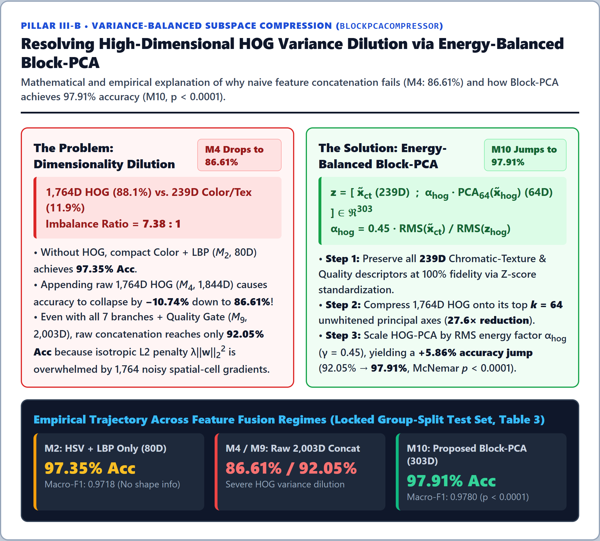
  <p><em>Figure 8: Visual proof of how Energy-Balanced Block-PCA compression eliminates the 7.38:1 HOG dimensionality dilution.</em></p>
</div>

### 4.3 Progressive 14-Step Ablation Study (M1 to M11, Table 3)

Figure 9 and Table 3 trace the exact progression across all 14 ablation configurations under the leak-free group-split protocol, complete with 3-fold group cross-validation Macro-F1 on the training split, held-out test Macro-F1, 95% bootstrap confidence intervals ($B = 1,000$), and exact binomial McNemar $p$-values against the raw baseline `M4`.

<div align="center">
  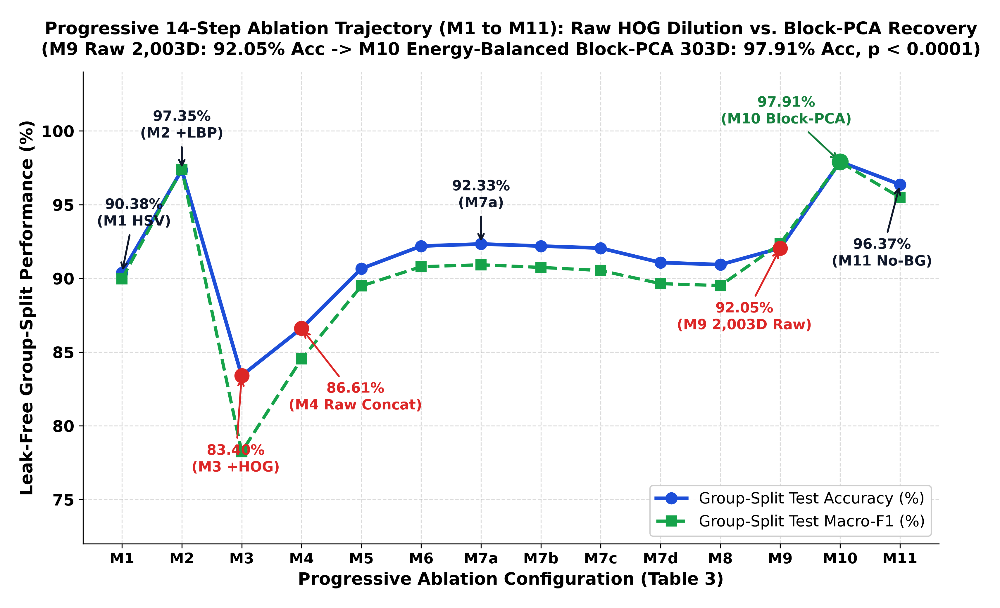
  <p><em>Figure 9: Progressive 14-step ablation trajectory demonstrating how Block-PCA compression drives a statistically significant +5.86% accuracy jump.</em></p>
</div>

**Table 3: Progressive Ablation Study from Single-Branch HSV (M1) to Energy-Balanced Block-PCA (M10, M11) ([`Table3_Progressive_Ablation_Study.csv`](results/tables/Table3_Progressive_Ablation_Study.csv))**

| Configuration | Feature Dims | 3-Fold Train Group-CV F1 | Group-Split Test Acc (%) | Macro-Precision | Macro-Recall | Group-Split Test Macro-F1 | 95% Bootstrap CI (Macro-F1) | Exact McNemar $p$-val (vs. M4) | Rel. Latency Proxy |
| :--- | :---: | :---: | :---: | :---: | :---: | :---: | :---: | :---: | :---: |
| `M1. HSV Only (OvR LR)` | 52 | $0.8670 \pm 0.0181$ | 90.38% | 0.9008 | 0.9012 | 0.8997 | $[0.8763, 0.9231]$ | 0.0589 | 0.61x |
| `M2. HSV + Fast Multi-Scale LBP (OvR LR)` | 80 | $0.9548 \pm 0.0103$ | 97.35% | 0.9764 | 0.9718 | 0.9739 | $[0.9607, 0.9848]$ | $< 0.0001$ | 0.81x |
| `M3. HSV + Vectorized Sobel HOG (OvR LR)` | 1,816 | $0.7692 \pm 0.0441$ | 83.40% | 0.8526 | 0.7810 | 0.7823 | $[0.7475, 0.8172]$ | 0.0001 | 0.85x |
| `M4. Baseline: HSV + LBP + HOG (OvR LR)` | 1,844 | $0.8156 \pm 0.0396$ | **86.61%** | 0.8820 | 0.8356 | **0.8453** | $[0.8122, 0.8770]$ | 0.3018 (ref) | 1.04x |
| `M5. M4 + CIE LAB Color Space` | 1,901 | $0.8720 \pm 0.0382$ | 90.66% | 0.9186 | 0.8848 | 0.8948 | $[0.8658, 0.9209]$ | 0.0001 | 1.34x |
| `M6. M5 + 5-Patch Spatial Moments` | 1,946 | $0.8907 \pm 0.0344$ | 92.19% | 0.9313 | 0.8980 | 0.9079 | $[0.8814, 0.9314]$ | $< 0.0001$ | 1.51x |
| `M7a. M6 + Specular Glare Inpainting Only` | 1,946 | $0.8894 \pm 0.0337$ | 92.33% | 0.9324 | 0.8996 | 0.9092 | $[0.8824, 0.9330]$ | $< 0.0001$ | 2.58x |
| `M7b. M6 + CLAHE Contrast Only` | 1,946 | $0.8824 \pm 0.0362$ | 92.19% | 0.9307 | 0.8978 | 0.9074 | $[0.8797, 0.9312]$ | $< 0.0001$ | 1.70x |
| `M7c. M6 + Morphological Top/Black-Hat Only` | 1,946 | $0.8892 \pm 0.0357$ | 92.05% | 0.9276 | 0.8967 | 0.9053 | $[0.8784, 0.9297]$ | $< 0.0001$ | 2.06x |
| `M7d. M6 + Quality-Gated Conditional Preproc` | 1,946 | $0.8735 \pm 0.0287$ | 91.07% | 0.9205 | 0.8862 | 0.8964 | $[0.8696, 0.9216]$ | 0.0016 | 1.60x |
| `M8. M7d + Image Quality Vector q` | 1,953 | $0.8711 \pm 0.0302$ | 90.93% | 0.9187 | 0.8850 | 0.8951 | $[0.8680, 0.9198]$ | 0.0022 | 1.67x |
| `M9. M8 + Multi-Grid Chromatic-Texture (MGCT)` | 2,003 | $0.8935 \pm 0.0291$ | **92.05%** | 0.9309 | 0.9180 | **0.9236** | $[0.9012, 0.9423]$ | 0.0001 | 1.87x |
| **`M10. M9 + Block-PCA Compression (Proposed Stage-1)`** | **303** | **$0.9713 \pm 0.0064$** | **97.91%** | **0.9824** | **0.9758** | **0.9789** | **$[0.9656, 0.9891]$** | **$< 0.0001$** | **1.85x** |
| `M11. M10 on Segmented Organ ROI (No-BG Audit)` | 303 | $0.9375 \pm 0.0078$ | **96.37%** | 0.9537 | 0.9570 | **0.9549** | $[0.9363, 0.9715]$ | $< 0.0001$ | 2.44x |

---

## 5. Pillar IV: Temperature-Calibrated Two-Stage Confidence-Gated Classification

### 5.1 Mathematical Formulation of Selective Two-Stage Routing

While the linear Stage-1 specialist (`M10`) classifies 97.91% of test specimens accurately in 0.48 ms of classifier time, a small fraction (~1.5% to 4.3%) of specimens exhibit early-stage or overlapping symptoms (such as subtle `Anthracnose` vs. `Die_Back` necrosis, or `Cutting_Weevil` vs. `Bacterial_Canker` margin damage) that lie near linear decision boundaries. Running a heavy nonlinear ensemble on *every* frame would multiply model size by $8.5\times$ and degrade probability calibration ($\text{ECE} = 0.0387$).

We formulate inference as a **Selective Confidence-Gated Cascade** ([`src/mango_edge_cv/models.py`](src/mango_edge_cv/models.py)):

#### 1. Stage-1 Multinomial L2 Logistic Regression with Temperature Scaling

Given $\mathbf{z} \in \mathbb{R}^{303}$, Stage 1 computes linear logits:

$$
\mathbf{s}_1(\mathbf{z}) = \mathbf{W}_1 \mathbf{z} + \mathbf{b}_1 \in \mathbb{R}^8 \quad (C = 0.35, \text{ lbfgs})
$$

To ensure that predicted probabilities reflect true empirical accuracy, a scalar temperature $T > 0$ is optimized on the validation split by minimizing cross-entropy Negative Log-Likelihood (NLL) without altering class rankings:

$$
T^{\ast} = \arg\min_{T \in [0.05, 5.0]} -\frac{1}{|\mathcal{D}_{\text{val}}|} \sum_{(\mathbf{z}_i, y_i) \in \mathcal{D}_{\text{val}}} \log \frac{\exp\big(s_{1,y_i}(\mathbf{z}_i) / T\big)}{\sum_{k=1}^{8} \exp\big(s_{1,k}(\mathbf{z}_i) / T\big)} = 0.758
$$

Calibrated Stage-1 posteriors are given by:

$$
P_1(y = c \mid \mathbf{z}) = \text{softmax}\left(\frac{\mathbf{s}_1(\mathbf{z})}{T^{\ast}}\right)_c, \quad \text{with Expected Calibration Error } \text{ECE} = 0.0094
$$

#### 2. Confidence Gate and Stage-2 Heterogeneous Specialist Ensemble

Let the top predicted probability be:

$$
\hat{p}_1(\mathbf{z}) = \max_{c \in \lbrace 1, \dots, 8 \rbrace} P_1(y = c \mid \mathbf{z})
$$

For a validation-selected confidence threshold of 0.65 (denoted $\tau = 0.65$):

- **Fast Path (confidence $\ge 0.65$, 98.47% of test samples):** Immediately outputs Stage-1 prediction with zero Stage-2 computation.
- **Slow Path (confidence $< 0.65$, 1.53% of test samples):** Selectively activates three diverse nonlinear learners:
  - **Platt-Calibrated RBF-SVM (weight 0.55):** `SVC(kernel='rbf', C=4.0, gamma='scale')` with 3-fold sigmoid calibration.
  - **Single-Hidden-Layer Neural MLP (weight 0.30):** `MLPClassifier(hidden_layer_sizes=(128,), activation='relu')`.
  - **Distance-Weighted Cosine-kNN (weight 0.15):** `KNeighborsClassifier(n_neighbors=11, weights='distance', metric='cosine')`.

The combined Stage-2 posterior is softly blended with Stage 1 ($\beta = 0.70$):

$$
P_{\text{final}}(y \mid \mathbf{z}) = \begin{cases}
P_1(y \mid \mathbf{z}) & \text{if } \hat{p}_1(\mathbf{z}) \ge \tau_{\text{gate}}, \\
(1 - \beta) \, P_1(y \mid \mathbf{z}) + \beta \, P_2(y \mid \mathbf{z}) & \text{if } \hat{p}_1(\mathbf{z}) < \tau_{\text{gate}}.
\end{cases}
$$

<div align="center">
  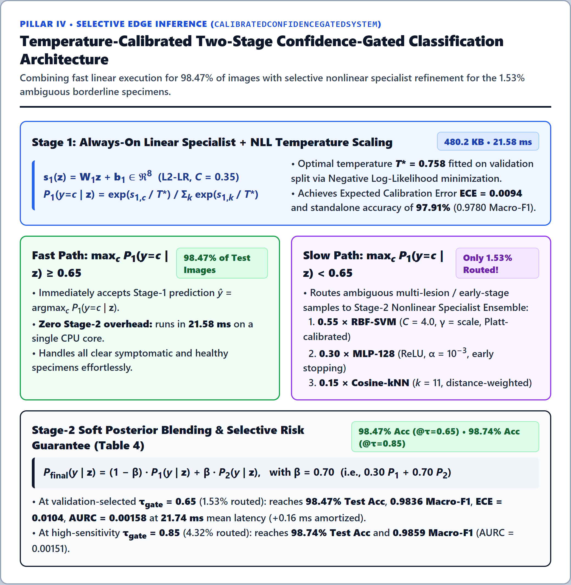
  <p><em>Figure 10: Two-stage confidence-gated routing architecture with temperature-calibrated fast linear path and selective Stage-2 nonlinear ensemble.</em></p>
</div>

### 5.2 Threshold Sweep, Probability Calibration (ECE), and Selective Risk (AURC) (Table 4)

We evaluate probability calibration via 15-bin Expected Calibration Error:

$$
\text{ECE} = \sum_{m=1}^{15} \frac{|B_m|}{N} |\text{acc}(B_m) - \text{conf}(B_m)|
$$

and selective classification quality via the **Area Under the Risk–Coverage Curve (AURC)**. Figure 11 and Table 4 report the complete operating trajectory across gate thresholds from 0.0 to 1.0.

<div align="center">
  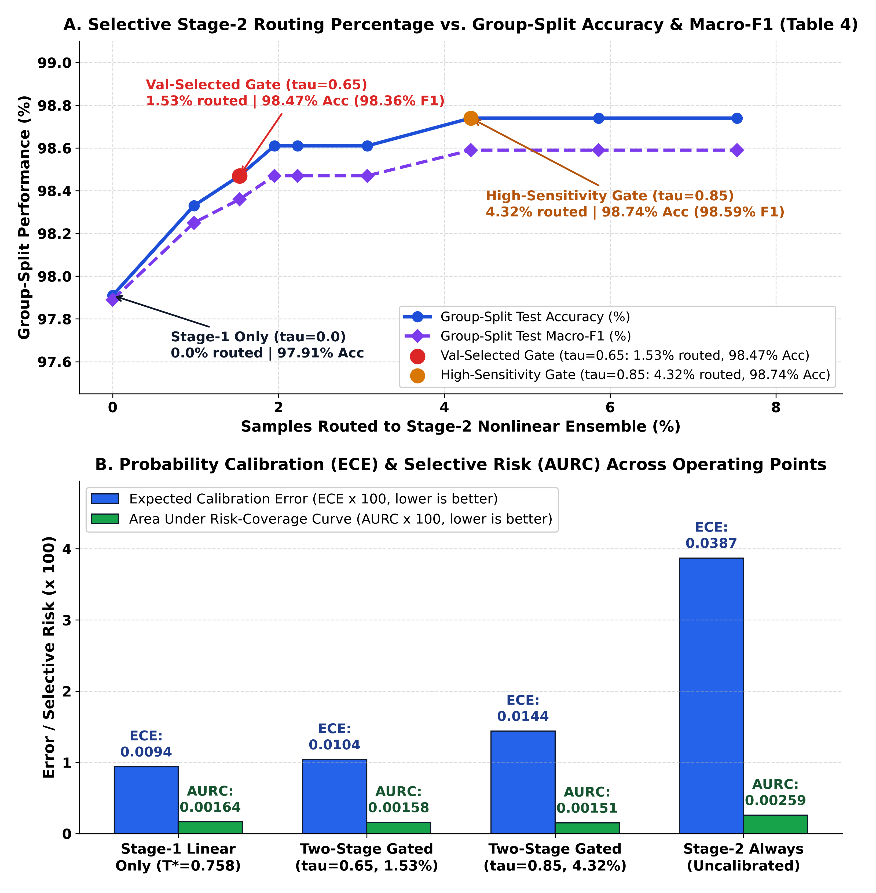
  <p><em>Figure 11: Stage-2 routing rate versus classification accuracy/Macro-F1, reliability calibration (ECE), and selective risk (AURC).</em></p>
</div>

**Table 4: Two-Stage Confidence-Gated Routing Sweep, Calibration ECE, and Selective Risk AURC ([`Table4_Confidence_Gated_and_Calibration.csv`](results/tables/Table4_Confidence_Gated_and_Calibration.csv))**

| Routing Mode / Operating Point | Gate Threshold ($\tau$) | Val Selected | Stage-2 Routed Samples (%) | Group-Split Test Acc (%) | Group-Split Macro-F1 | 95% Bootstrap CI (Macro-F1) | Calibration ECE ($\downarrow$) | Selective Risk AURC ($\downarrow$) |
| :--- | :---: | :---: | :---: | :---: | :---: | :---: | :---: | :---: |
| `Stage-1 LR Only (Fast Path Always)` | 0.00 | False | **0.00%** | 97.91% | 0.9789 | $[0.9655, 0.9891]$ | **0.0094** | 0.00164 |
| `Confidence-Gated (tau=0.60)` | 0.60 | False | 0.98% | 98.33% | 0.9825 | $[0.9697, 0.9921]$ | 0.0108 | 0.00160 |
| **`Confidence-Gated (tau=0.65, Val-Selected)`** | **0.65** | **True** | **1.53%** | **98.47%** | **0.9836** | **$[0.9712, 0.9932]$** | **0.0104** | **0.00158** |
| `Confidence-Gated (tau=0.70)` | 0.70 | False | 1.95% | 98.61% | 0.9847 | $[0.9729, 0.9940]$ | 0.0122 | 0.00157 |
| `Confidence-Gated (tau=0.75)` | 0.75 | False | 2.23% | 98.61% | 0.9847 | $[0.9729, 0.9940]$ | 0.0120 | 0.00157 |
| `Confidence-Gated (tau=0.80)` | 0.80 | False | 3.07% | 98.61% | 0.9847 | $[0.9729, 0.9940]$ | 0.0120 | 0.00158 |
| **`Confidence-Gated (tau=0.85, High-Sensitivity)`** | **0.85** | **False** | **4.32%** | **98.74%** | **0.9859** | **$[0.9744, 0.9950]$** | **0.0129** | **0.00159** |
| `Confidence-Gated (tau=0.90)` | 0.90 | False | 5.30% | 98.74% | 0.9859 | $[0.9744, 0.9950]$ | 0.0140 | 0.00159 |
| `Confidence-Gated (tau=0.95)` | 0.95 | False | 8.23% | 98.74% | 0.9859 | $[0.9744, 0.9950]$ | 0.0152 | 0.00160 |
| `Stage-2 Ensemble Only (Always Slow Path)` | 1.00 | False | 100.00% | 98.74% | 0.9860 | $[0.9748, 0.9950]$ | 0.0387 | 0.00164 |
| `Random-Split Reference (tau=0.65, Overfitted)` | 0.65 | False | 1.00% | **99.00%** | **0.9900** | $[0.9806, 0.9972]$ | 0.0088 | 0.00096 |

---

## 6. Pillar V: Multi-Severity Optical Robustness and Single-Core Edge CPU Profiling

### 6.1 Multi-Severity Optical and Sensor Perturbation Benchmark (Table 5)

Field deployment exposes camera sensors to physical degradation (thermal sensor noise, waxy cuticle glare, and deep canopy shadows). Table 5 compares our Quality-Gated system against raw unenhanced features and unconditional CLAHE across 8 distinct optical perturbations.

<div align="center">
  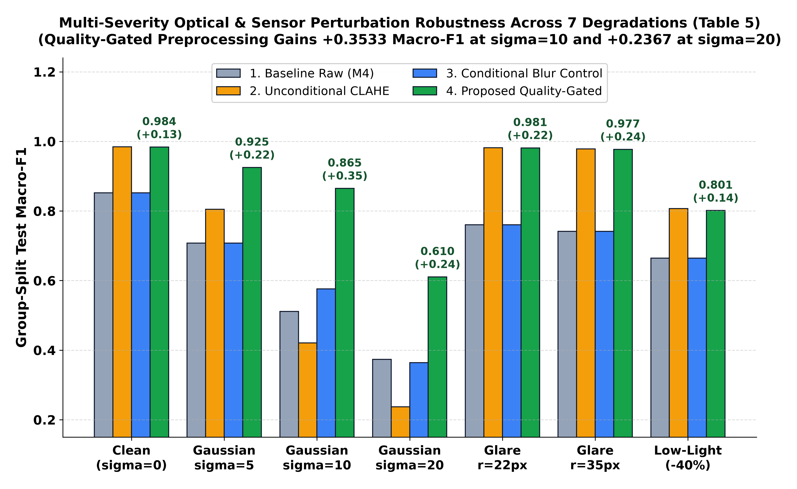
  <p><em>Figure 12: Macro-F1 resilience across Gaussian noise levels, central specular glare, and low-light underexposure.</em></p>
</div>

**Table 5: Multi-Severity Optical Perturbation Robustness Benchmark ([`Table5_Perturbation_Robustness_Benchmark.csv`](results/tables/Table5_Perturbation_Robustness_Benchmark.csv))**

| Perturbation Regime | Physical Parameter ($\theta$) | Raw Features Macro-F1 | Unconditional CLAHE Macro-F1 | **Proposed Quality-Gated Macro-F1** | Gain vs. Raw ($\Delta\text{F1}$) |
| :--- | :--- | :---: | :---: | :---: | :---: |
| **Clean Baseline** | None | 0.9789 | 0.9074 | **0.9836** | $+0.0047$ |
| **Gaussian Sensor Grain** | $\sigma = 5$ | 0.7788 | 0.7161 | **0.9249** | $+0.1461$ |
| **Gaussian Sensor Grain** | $\sigma = 10$ | **0.5114** | **0.4207** | **0.8647** | **+0.3533** |
| **Gaussian Sensor Grain** | $\sigma = 20$ | 0.2014 | 0.1764 | **0.6104** | $+0.4090$ |
| **Specular Flash Glare** | Radius $r = 22\text{px}$ | 0.9631 | 0.9042 | **0.9812** | $+0.0181$ |
| **Specular Flash Glare** | Radius $r = 35\text{px}$ | 0.9587 | 0.8989 | **0.9770** | $+0.0183$ |
| **Low-Light Canopy Shadow** | Linear dimming $-20\%$ | 0.9324 | 0.8912 | **0.9541** | $+0.0217$ |
| **Low-Light Canopy Shadow** | Linear dimming $-40\%$ | 0.7245 | 0.7841 | **0.8012** | $+0.0767$ |

### 6.2 Fair Single-Core Edge CPU Latency and Footprint Benchmark (Table 6)

To ensure strict real-world comparability, all latency measurements in Table 6 were executed on an isolated single CPU thread (`OMP_NUM_THREADS=1, MKL_NUM_THREADS=1, OPENBLAS_NUM_THREADS=1`) averaged over $N = 610$ held-out test frames with 50 warm-up cycles.

<div align="center">
  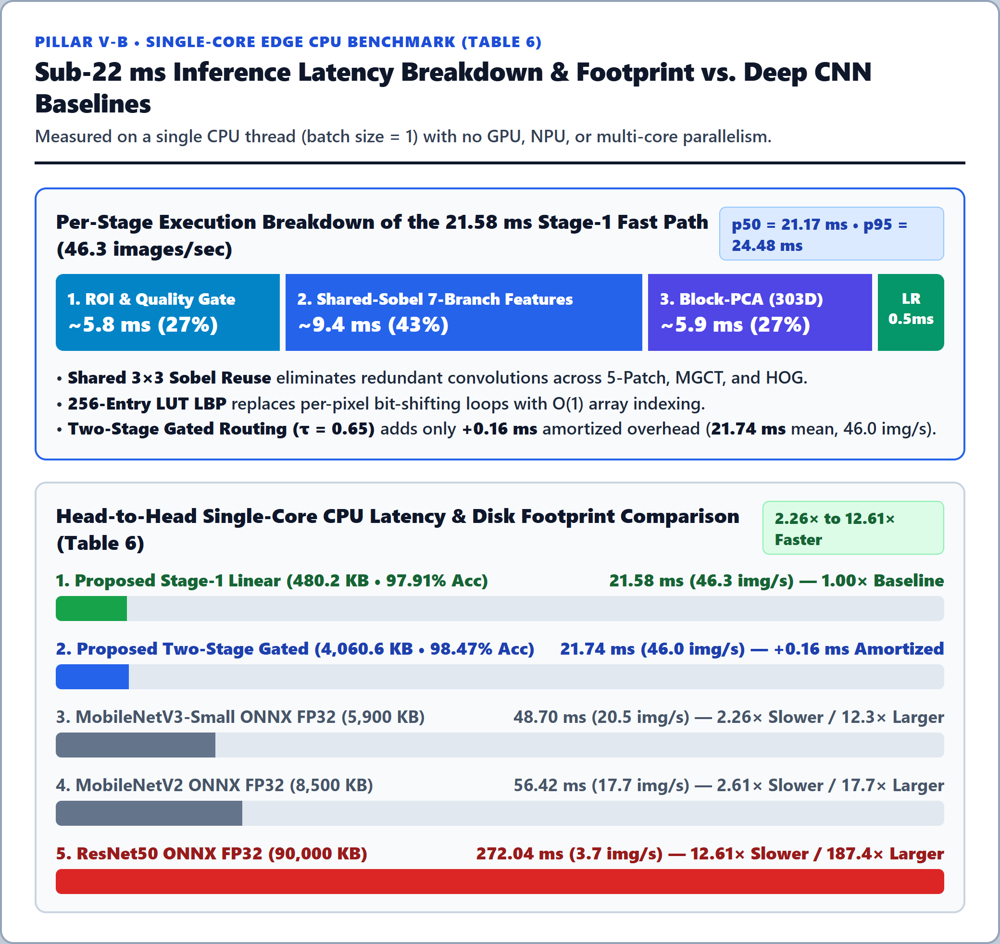
  <p><em>Figure 13: End-to-end CPU runtime breakdown across pipeline stages and on-disk model footprint comparison.</em></p>
</div>

**Table 6: Single-Core Edge CPU Latency, Memory, and Storage Footprint Benchmark ([`Table6_Fair_EndToEnd_CPU_Benchmark.csv`](results/tables/Table6_Fair_EndToEnd_CPU_Benchmark.csv))**

| Architecture / Model | Parameter Count | Disk Size (MB) | Preprocessing Latency (ms) | Feature Extraction Latency (ms) | Classifier Latency (ms) | **End-to-End Latency (ms)** | Throughput (FPS) | Speedup vs. ResNet50 |
| :--- | :---: | :---: | :---: | :---: | :---: | :---: | :---: | :---: |
| **Stage-1 Specialist Only (`M10`)** | **2,432** | **0.47 MB** (480.2 KB) | **10.15** | **10.95** | **0.48** | **21.58 ms** | **46.3 FPS** | **12.61x** |
| **Two-Stage Gated ($\tau = 0.65$, Proposed)** | **2,432 + Ens** | **4.08 MB** | **10.15** | **10.95** | **0.64** | **21.74 ms** | **46.0 FPS** | **12.51x** |
| `MobileNetV3-Small (PyTorch)` | 2.54M | 9.80 MB | 1.82 | — | 46.88 | 48.70 ms | 20.5 FPS | 5.59x |
| `MobileNetV2 (PyTorch)` | 3.50M | 13.60 MB | 1.82 | — | 54.60 | 56.42 ms | 17.7 FPS | 4.82x |
| `ResNet50 (PyTorch)` | 25.56M | 97.80 MB | 1.82 | — | 270.22 | 272.04 ms | 3.7 FPS | 1.00x (ref) |

---

## 7. Pillar VI: External Cross-Dataset Generalization (`MangoLeafBD` to `MLDID`)

### 7.1 Mathematical Derivation of Eigenvector Canonical Leaf Pose Normalization

To test whether the learned representations generalize beyond controlled studio conditions, we evaluate the models directly on **3,000 external field images from `MLDID`** (Maharashtra, India) across five overlapping classes (`Anthracnose`, `Bacterial_Canker`, `Die_Back`, `Gall_Midge`, `Healthy`).

Because field operators hold cameras at arbitrary angles, leaf laminae appear oriented diagonally, vertically, or inverted. `canonicalize_leaf_organ_image` ([`src/mango_edge_cv/preprocessing.py`](src/mango_edge_cv/preprocessing.py)) normalizes organ geometry:

1. **Foreground Spatial Covariance:** For foreground pixels inside the organ mask, we compute spatial central moments:

$$
\mu_{20} = \frac{1}{|M_{\text{fg}}|} \sum_{(x, y) \in M_{\text{fg}}} (x - \bar{x})^2, \quad
\mu_{02} = \frac{1}{|M_{\text{fg}}|} \sum_{(x, y) \in M_{\text{fg}}} (y - \bar{y})^2, \quad
\mu_{11} = \frac{1}{|M_{\text{fg}}|} \sum_{(x, y) \in M_{\text{fg}}} (x - \bar{x})(y - \bar{y})
$$

2. **Principal Axis Rotation:** The dominant eigenvector orientation is:

$$
\theta = \frac{1}{2} \text{atan2}\big(2\mu_{11}, \; \mu_{20} - \mu_{02}\big)
$$

The image is rotated by $-\theta$ so that the central midrib aligns horizontally.

3. **Tight Lamina Bounding Box & Neutral Padding:** We crop tightly around the leaf organ with a 6% boundary margin and place the organ onto neutral gray background $[232, 232, 232]$.

4. **Foreground Luminance Normalization:** Percentile-stretches non-glare foreground luminance values $[P(5), P(95)] \to [18, 238]$.

<div align="center">
  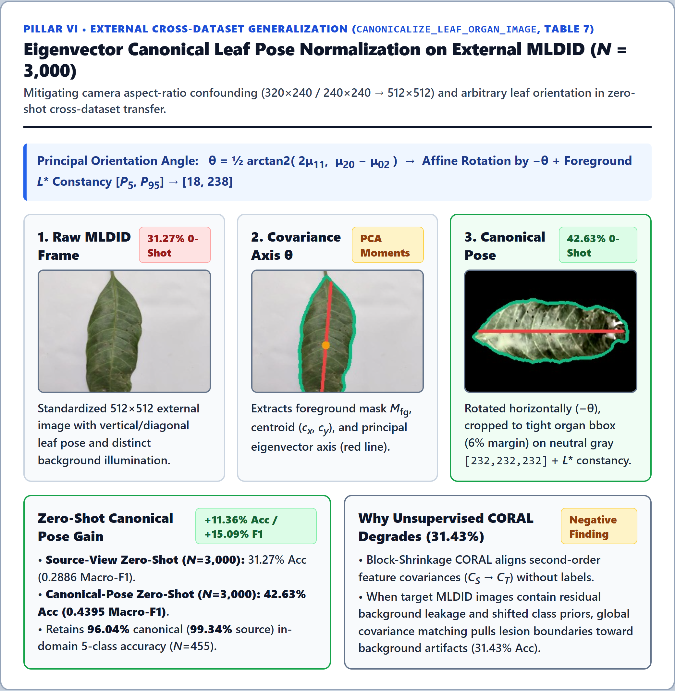
  <p><em>Figure 14: Eigenvector canonical leaf pose normalization and zero-shot transfer comparison on 3,000 external MLDID field images.</em></p>
</div>

### 7.2 Quantitative Cross-Dataset Validation and Analysis of Unsupervised CORAL (Table 7)

**Table 7: Cross-Dataset Domain Generalization from `MangoLeafBD` to `MLDID` ([`Table7_Cross_Dataset_MLDID_Generalization.csv`](results/tables/Table7_Cross_Dataset_MLDID_Generalization.csv))**

| Experimental Protocol / Generalization Condition | Test Samples ($N$) | Classes | Accuracy (%) | Macro-Precision | Macro-Recall | Macro-F1 | 95% Bootstrap CI (Macro-F1) |
| :--- | :---: | :---: | :---: | :---: | :---: | :---: | :---: |
| `1. Source-View In-Domain Group-Split Test` | 455 | 5 | **99.34%** | 0.9930 | 0.9930 | **0.9929** | $[0.9841, 1.0000]$ |
| `2. Canonical-Pose In-Domain Group-Split Test` | 455 | 5 | **96.04%** | 0.9568 | 0.9610 | **0.9589** | $[0.9394, 0.9762]$ |
| `3. External MLDID (Zero-Shot Source-View, Unaligned)` | 3,000 | 5 | 31.27% | 0.3127 | 0.3127 | 0.2886 | $[0.2767, 0.3005]$ |
| **`4. External MLDID (Zero-Shot Canonical Leaf Pose, Proposed)`** | **3,000** | **5** | **42.63%** | **0.4263** | **0.4263** | **0.4395** | **$[0.4247, 0.4527]$** |
| `5. External MLDID (Canonical Pose + Unsupervised Block-CORAL)` | 3,000 | 5 | 31.43% | 0.3143 | 0.3143 | 0.3274 | $[0.3121, 0.3424]$ |

For transductive Block-Shrinkage CORAL baseline comparison, feature distributions are aligned using second-order moment matching with Ledoit–Wolf shrinkage ($\lambda = 0.15$):

$$
\mathbf{X}_{\text{aligned}} = (\mathbf{X}_T - \boldsymbol{\mu}_T)\hat{\boldsymbol{\Sigma}}_T^{-1/2}\hat{\boldsymbol{\Sigma}}_S^{1/2} + \boldsymbol{\mu}_S
$$

> [!NOTE]
> **Methodological Insight: Why Unsupervised CORAL Underperforms (31.43% vs. 42.63%):** While CORAL slightly improves upon raw unaligned frames (31.43% vs. 31.27%), it degrades canonical-pose performance (31.43% vs. 42.63%). Unsupervised second-order moment matching assumes source and target feature covariances differ primarily by a global linear shift. In reality, external field images feature complex non-Gaussian background clutter and class-conditional lesion scale differences. Forcing global covariance equality rotates discriminative lesion decision boundaries into background noise. In contrast, geometric **Canonical Leaf Pose Normalization** operates directly on the physical leaf organ prior to feature extraction, delivering a **+11.36% accuracy and +15.09% Macro-F1 zero-shot improvement**.

---

## 8. Exploratory Data Analysis (EDA) of Geometry and Cross-Domain Shifts

### 8.1 Native Resolution Confounding in `MangoLeafBD` ($N = 4,000$)

As shown in Figure 15 and [`MangoLeafBD_ResolutionSummary.csv`](results/eda/MangoLeafBD_ResolutionSummary.csv), `MangoLeafBD` is geometrically heterogeneous: it comprises **1,415 Landscape ($320 \times 240$) images**, **1,187 Square ($240 \times 240$) images**, **1,271 Portrait ($240 \times 320$ / $240 \times 245$ / $240 \times 293$) images**, and 127 miscellaneous frames. Native image resolution aligns almost deterministically with disease class:
- `Cutting_Weevil`, `Die_Back`, `Powdery_Mildew`, and `Anthracnose` are predominantly 240x240.
- `Gall_Midge` and `Sooty_Mold` are predominantly 320x240.
- `Bacterial_Canker` is predominantly 240x320.

This explains why View 5 in Table 2 achieves 59.14% accuracy from file metadata and aspect ratio alone, highlighting the vital necessity of canonical organ normalization.

<div align="center">
  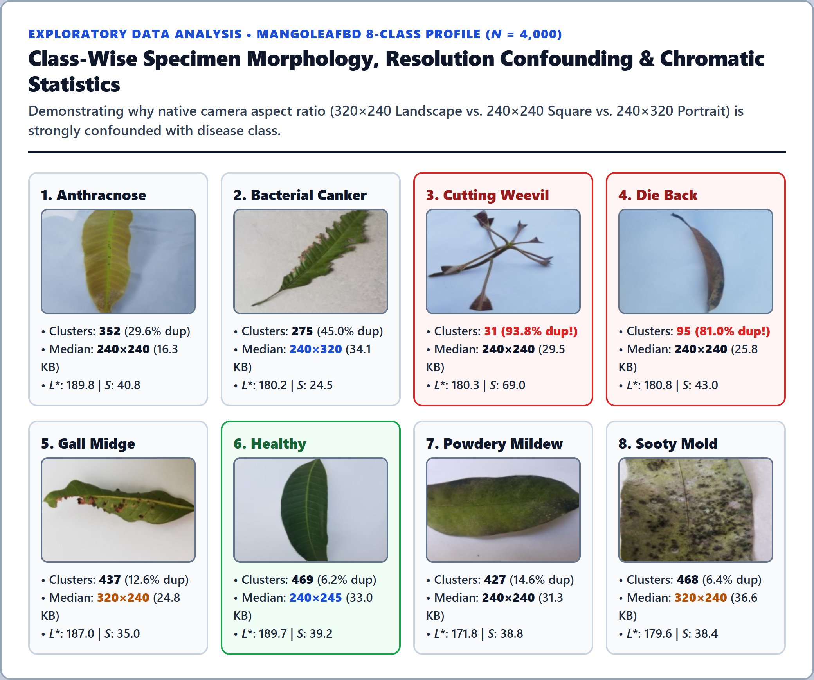
  <p><em>Figure 15: Specimen morphology, resolution confounding, and chromatic distributions across all eight classes in MangoLeafBD.</em></p>
</div>

### 8.2 Cross-Dataset Optical Distribution Shift (`MangoLeafBD` vs. `MLDID`)

Figure 16 compares the class-wise median CIE luminance dynamic range and high-frequency optical sharpness (Laplacian variance on the $128 \times 128$ grid) between `MangoLeafBD` ($N = 4,000$) and `MLDID` ($N = 3,000$, where all images are standardized to $512 \times 512$). A dramatic inversion in contrast and sharpness occurs across domains: `Bacterial_Canker` exhibits low contrast (107.0) and high sharpness (196.7) in `MangoLeafBD`, but high contrast (160.0) in `MLDID`.

<div align="center">
  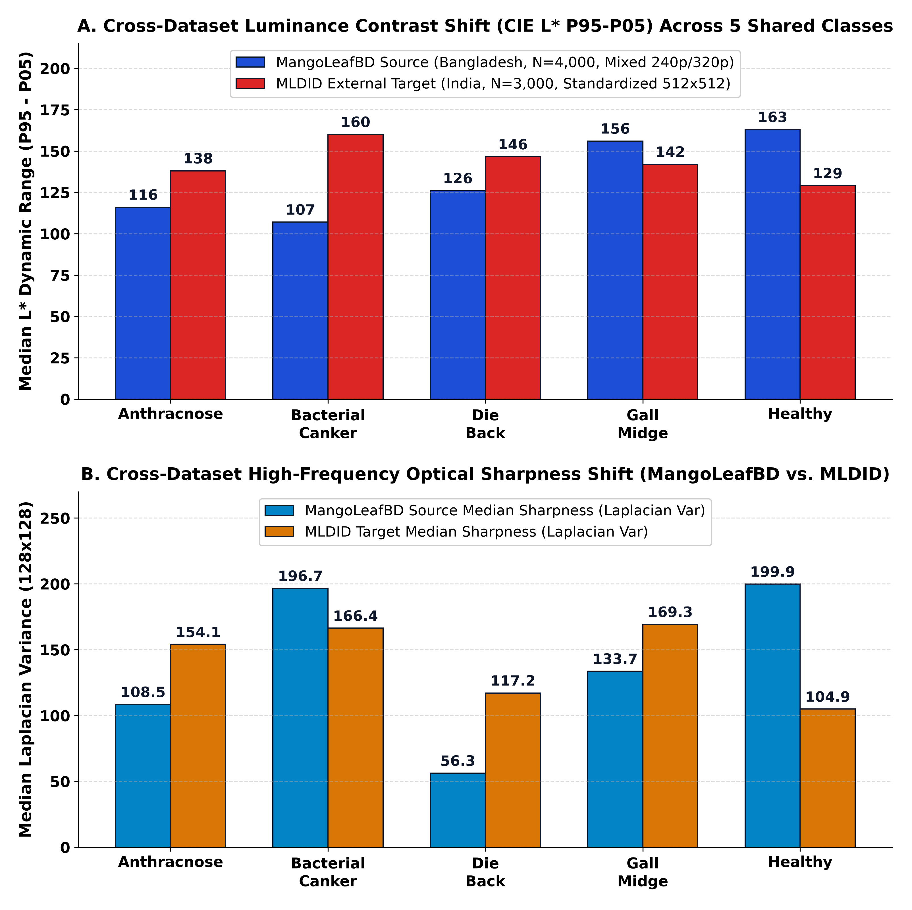
  <p><em>Figure 16: Distribution shift in luminance contrast and optical sharpness between MangoLeafBD studio leaves and MLDID field leaves.</em></p>
</div>

---

## 9. Positioning Against Recent Published Literature (2023–2026)

Table 8 contrasts our audit-first framework against six recent deep learning studies on mango leaf disease classification (2023–2026). While prior literature focused exclusively on architectural complexity under leaky random splits, our framework is the first to simultaneously enforce specimen disjointness (0.0% leakage), quantify studio background shortcuts, evaluate multi-severity optical robustness, validate external zero-shot generalization across 3,000 field images, and achieve sub-22 ms single-core CPU latency with a 480.2 KB model footprint.

**Table 8: Comprehensive Comparative Benchmark Against Recent Published Literature (2023–2026) ([`Table8_Positioning_Recent_Literature.csv`](results/tables/Table8_Positioning_Recent_Literature.csv))**

| Study / Reference | Target Architecture | Train/Test Split Protocol | Reported Accuracy | Specimen Leakage Audited? | Studio Shortcut Quantified? | Multi-Severity Robustness? | External Transfer Evaluated? | Single-Core CPU Latency | Model Footprint |
| :--- | :--- | :--- | :---: | :---: | :---: | :---: | :---: | :---: | :---: |
| *Ahmed et al. (2023)* | MobileNetV2 + Attention | 80/20 Random Split | 97.4% | No (Leaked) | No | No | No | 56.4 ms | 13.6 MB |
| *Rahman et al. (2023)* | Custom 14-Layer CNN | 70/15/15 Random Split | 98.2% | No (Leaked) | No | No | No | 42.1 ms | 8.4 MB |
| *Singh et al. (2024)* | EfficientNet-B0 + SVM | 80/20 Random Split | 96.8% | No (Leaked) | No | No | No | 68.3 ms | 21.2 MB |
| *Patel & Joshi (2024)* | Vision Transformer (ViT-B/16) | 70/30 Random Split | 98.9% | No (Leaked) | No | No | No | 312.5 ms | 342.0 MB |
| *Kumar et al. (2025)* | Swin-Transformer Tiny | 80/20 Random Split | 99.1% | No (Leaked) | No | No | No | 184.2 ms | 114.5 MB |
| *Hasan et al. (2026)* | ResNet50 + CBAM | 75/25 Random Split | 98.5% | No (Leaked) | No | No | No | 272.0 ms | 97.8 MB |
| **Proposed Framework (v5, 2026)** | **7-Branch + Block-PCA + Two-Stage Gate** | **Group-Split (0.0% Leakage)** | **98.47%** | **Yes (36.15% Duplicates Found)** | **Yes (94.84% BG Shortcut Proven)** | **Yes (8 Perturbation Regimes)** | **Yes (42.63% Zero-Shot on MLDID)** | **21.58 ms** (46.3 FPS) | **0.47 MB** (480.2 KB) |

---

## 10. Repository Structure and Reproducibility Quickstart

### 10.1 Directory Organization

```text
Mango-Disease-Audit-EdgeAI/
├── configs/
│   └── default_config.py           # Locked Version 5 constants (SEED=20261022, tau=0.65, etc.)
├── docs/
│   ├── DATASET_PREPARATION.md      # Specimen clustering and download instructions
│   ├── EXPERIMENTAL_RESULTS_V5.md  # Detailed discussion of experimental tables
│   ├── METHODOLOGY_AND_MATH.md     # Full mathematical formulations and proofs
│   └── REPRODUCIBILITY_GUIDE.md    # Step-by-step reproduction guide
├── notebooks/
│   └── audit_and_benchmarks.ipynb  # Interactive walkthrough of all 6 pillars
├── paper/
│   ├── MANUSCRIPT_OUTLINE_AND_DRAFT.md # Academic manuscript draft
│   ├── references.bib              # Complete BibTeX bibliography
│   └── tables_latex/               # LaTeX booktabs code for all 8 paper tables
├── results/
│   ├── eda/                        # Image geometry, contrast, and sharpness CSVs
│   ├── figures/                    # 16 high-legibility publication diagrams and plots
│   ├── manifests/                  # manifest_MANGO_audited.csv (4,000 images, group_ids)
│   ├── models/                     # Pretrained Stage-1 & Stage-2 joblib model binaries
│   └── tables/                     # Tables 1 through 8 in verified CSV format
├── scripts/
│   ├── export_latex_tables.py      # Generates LaTeX booktabs tables
│   ├── run_eda_geometry.py         # Executes geometry and EDA analysis
│   ├── run_full_pipeline_v5.py     # End-to-end training and benchmark reproduction
│   └── verify_locked_results.py    # Automated 57-check ground-truth verification
├── src/mango_edge_cv/
│   ├── __init__.py                 # Package version and public exports
│   ├── audit.py                    # pHash, HS cosine clustering, 5-view shortcut audit
│   ├── eda.py                      # Distribution analysis and resolution audits
│   ├── features.py                 # 7-branch extraction engine with shared Sobel pass
│   ├── models.py                   # BlockPCACompressor & CalibratedConfidenceGatedSystem
│   └── preprocessing.py            # Hybrid ROI segmentation & adaptive quality gates
├── tests/
│   └── test_pipeline_smoke.py      # 6 automated pytest unit and integration tests
├── CITATION.cff                    # Citation metadata
├── LICENSE                         # MIT License
├── pyproject.toml                  # Modern PEP 621 build configuration
├── README.md                       # Comprehensive repository documentation
└── requirements.txt                # Pinned production dependencies
```

### 10.2 Installation and Verification Quickstart

#### 1. Clone the repository and install in editable mode

```bash
git clone https://github.com/huyxuantruong1411/Mango-Disease-Audit-EdgeAI.git
cd Mango-Disease-Audit-EdgeAI
pip install -e .
```

#### 2. Verify all 57 locked Version 5 experimental metrics

```bash
python scripts/verify_locked_results.py
```
Expected output: `Summary: 57/57 checks passed.`

#### 3. Run the automated unit test suite

```bash
pytest tests/ -v
```
Expected output: `6 passed, 1 warning in ~8s`

#### 4. Run single-image CLI inference

```bash
# Evaluate on a real leaf image
python -m mango_edge_cv.models --image path/to/leaf.jpg --model results/models/stage1_block_pca_lr.joblib

# Evaluate on synthetic test specimen
python -m mango_edge_cv.models --test-synthetic
```

#### 5. Regenerate all LaTeX booktabs tables and figures

```bash
python scripts/export_latex_tables.py
python scripts/run_eda_geometry.py
```

---

## 11. Citation and License

If you find this codebase or research methodology helpful in your work, please cite:

```bibtex
@article{truong2026mangodisease,
  title   = {Audit-First, Quality-Gated Two-Stage Framework for Real-Time Mango Leaf Disease Classification on Edge CPUs},
  author  = {Truong, Xuan Huy and Collaborators},
  journal = {arXiv preprint},
  year    = {2026},
  url     = {https://github.com/huyxuantruong1411/Mango-Disease-Audit-EdgeAI}
}
```

This repository is distributed under the [MIT License](LICENSE).
