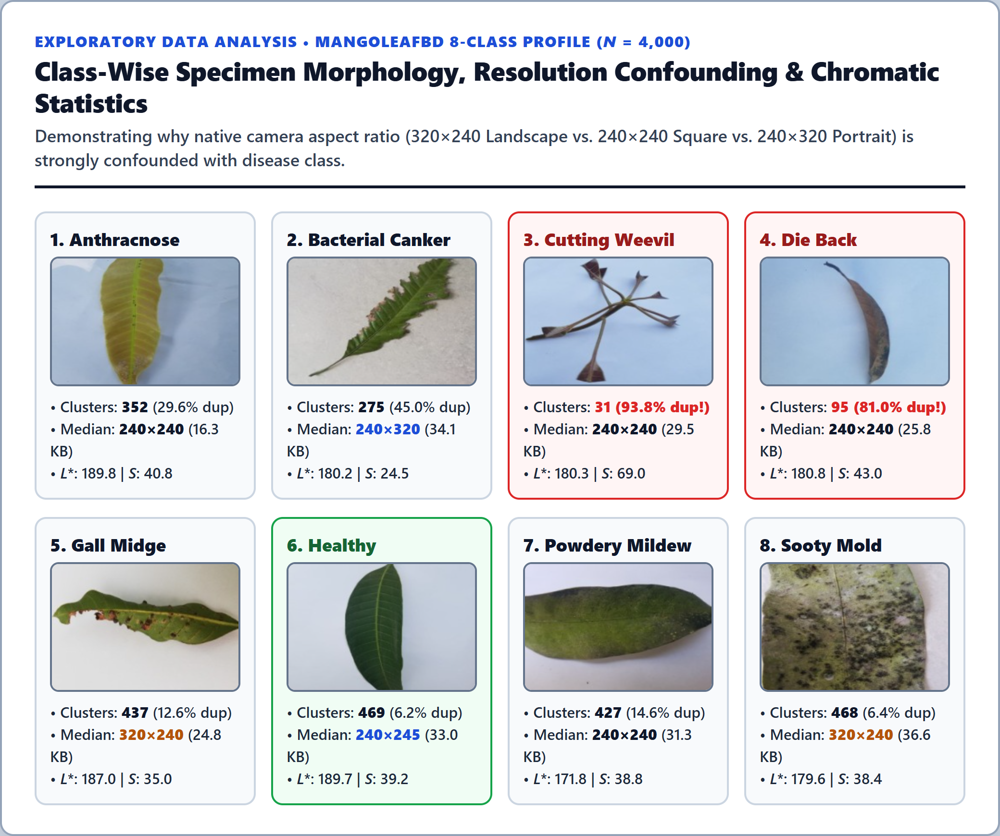
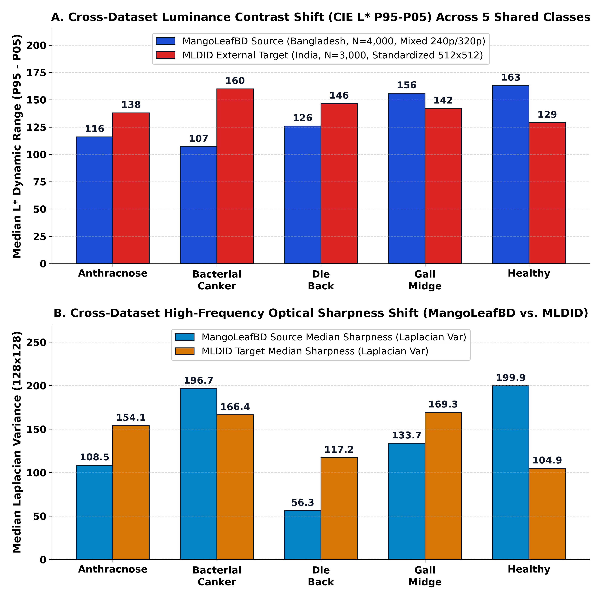

# Dataset Preparation, Geometry Confounding, and Specimen Audit Guide

This document details the acquisition, directory layout, physical geometry characteristics, and specimen-cluster auditing procedure for the two mango foliar pathology benchmarks evaluated in this study: **`MangoLeafBD`** ($N = 4,000$, Bangladesh) and **`MLDID`** ($N = 3,000$, India).

---

## 1. Primary Benchmark: `MangoLeafBD` ($N = 4,000$, 8 Classes)

- **Source Citation:** Ali et al. (2022), *"MangoLeafBD: A comprehensive image dataset to classify diseased and healthy mango leaves"*, Mendeley Data / *Data in Brief*.
- **Class Balance:** Exactly $500$ JPEG images per class across $8$ categories ($4,000$ images total):
  1. `Anthracnose` ($500$ images $\to 352$ unique specimen clusters, $29.6\%$ near-duplicate ratio)
  2. `Bacterial_Canker` ($500$ images $\to 275$ unique specimen clusters, $45.0\%$ near-duplicate ratio)
  3. `Cutting_Weevil` ($500$ images $\to 31$ unique specimen clusters, **$93.8\%$ near-duplicate ratio**)
  4. `Die_Back` ($500$ images $\to 95$ unique specimen clusters, **$81.0\%$ near-duplicate ratio**)
  5. `Gall_Midge` ($500$ images $\to 437$ unique specimen clusters, $12.6\%$ near-duplicate ratio)
  6. `Healthy` ($500$ images $\to 469$ unique specimen clusters, $6.2\%$ near-duplicate ratio)
  7. `Powdery_Mildew` ($500$ images $\to 427$ unique specimen clusters, $14.6\%$ near-duplicate ratio)
  8. `Sooty_Mold` ($500$ images $\to 468$ unique specimen clusters, $6.4\%$ near-duplicate ratio)



### 1.1 Native Resolution and Aspect-Ratio Confounding ([`MangoLeafBD_ResolutionSummary.csv`](../results/eda/MangoLeafBD_ResolutionSummary.csv))

A critical finding of our Exploratory Data Analysis (`src/mango_edge_cv/eda.py`) is that `MangoLeafBD` images were captured across three distinct aspect ratios that correlate strongly with disease labels:
- **Landscape `320x240` ($1,415$ images, $35.38\%$):** Dominates `Gall_Midge` and `Sooty_Mold`.
- **Square `240x240` ($1,187$ images, $29.68\%$):** Dominates `Cutting_Weevil`, `Die_Back`, `Powdery_Mildew`, and `Anthracnose`.
- **Portrait `240x320` ($499$ images), `240x245` ($462$ images), `240x293` ($310$ images):** Dominates `Bacterial_Canker` and `Healthy`.

---

## 2. External Cross-Dataset Benchmark: `MLDID` ($N = 3,000$, 5 Shared Classes)

- **Dataset Overview:** Independent mango leaf disease collection captured in India (`Resize mango leaf disease`), comprising $3,000$ images ($600$ images per class) across the $5$ shared classes: `Anthracnose`, `Bacterial_Canker`, `Die_Back`, `Gall_Midge`, and `Healthy`.
- **Standardized Geometry ([`MLDID_ResolutionSummary.csv`](../results/eda/MLDID_ResolutionSummary.csv)):** All $3,000$ images are standardized to **$512\times512$ ($100.0\%$)** with arbitrary leaf orientations (vertical, diagonal, and horizontal poses) and distinct illumination/sharpness profiles compared to `MangoLeafBD`.



---

## 3. Expected Directory Structure for Full Raw Image Execution

Note that **you do not need the raw image folders to verify the locked Version 5 results or run inference demos**, because the repository already ships with the audited manifest ([`results/manifests/manifest_MANGO_audited.csv`](../results/manifests/manifest_MANGO_audited.csv)), all locked CSV tables ([`results/tables/`](../results/tables/)), and the pretrained `joblib` models ([`results/models/`](../results/models/)).

To re-extract all $7,000$ images from scratch via [`scripts/run_full_audit_and_ablation.py`](../scripts/run_full_audit_and_ablation.py), place the raw datasets at:

```text
data/
├── MangoLeafBD/
│   ├── Anthracnose/
│   ├── Bacterial Canker/
│   ├── Cutting Weevil/
│   ├── Die Back/
│   ├── Gall Midge/
│   ├── Healthy/
│   ├── Powdery Mildew/
│   └── Sooty Mould/
└── MLDID/
    ├── Anthracnose/
    ├── Bacterial Canker/
    ├── Die Back/
    ├── Gall Midge/
    └── Healthy/
```
