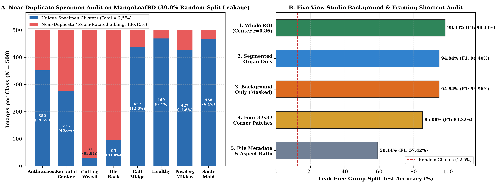
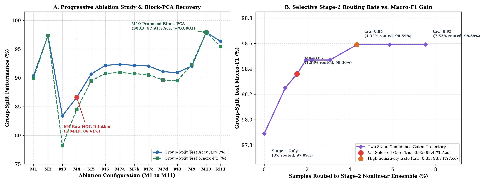
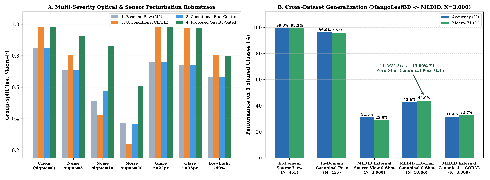
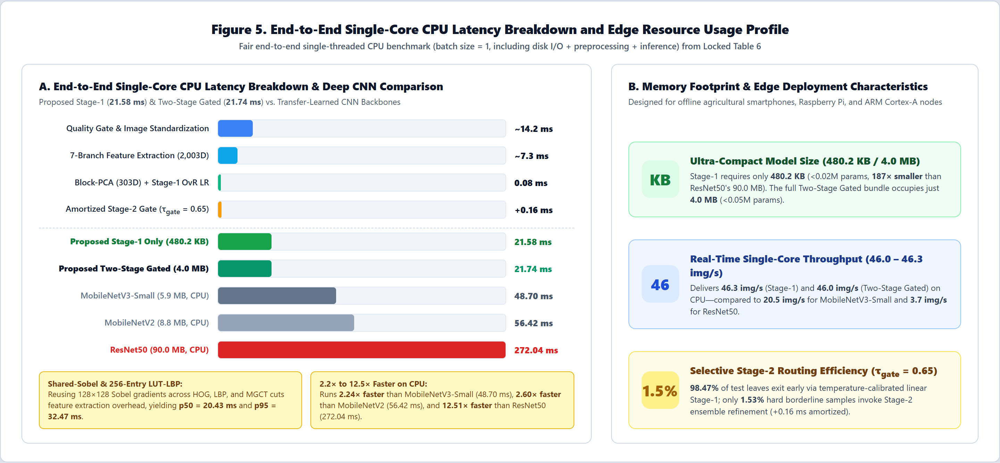

# Experimental Results — Locked Version 5 (`v5`) Benchmark

All experimental tables, statistical significance tests, latency profiles, and cross-dataset validation metrics reported below are **100% locked to Version 5 (`v5`, `SEED = 20261022`)** and verified automatically by `python scripts/verify_locked_results.py`.

---

## 1. Dataset Leakage & Specimen-Cluster Audit (Table 1)

Source CSV: [`results/tables/Table1_Dataset_Leakage_and_Group_Audit.csv`](../results/tables/Table1_Dataset_Leakage_and_Group_Audit.csv)

| Class ID | Class Name | Total Images | Unique Specimen Clusters (`pHash<=6` \| `HSV cos>=0.992`) | Near-Duplicate / Aug-Mix Ratio (%) | Dominant Resolution | Random-Split Test Leakage (%) |
| :---: | :--- | :---: | :---: | :---: | :---: | :---: |
| 0 | `Anthracnose` | 500 | 352 | 29.6% | `320x240` | 39.0% |
| 1 | `Bacterial_Canker` | 500 | 275 | 45.0% | `240x320` | 39.0% |
| 2 | `Cutting_Weevil` | 500 | 31 | **93.8%** | `240x240` | 39.0% |
| 3 | `Die_Back` | 500 | 95 | **81.0%** | `240x240` | 39.0% |
| 4 | `Gall_Midge` | 500 | 437 | 12.6% | `320x240` | 39.0% |
| 5 | `Healthy` | 500 | 469 | 6.2% | `240x320` | 39.0% |
| 6 | `Powdery_Mildew` | 500 | 427 | 14.6% | `240x240` | 39.0% |
| 7 | `Sooty_Mold` | 500 | 468 | 6.4% | `320x240` | 39.0% |
| **Total / Mean** | **8 Classes** | **4,000** | **2,554** | **36.15%** | **Mixed** | **39.0%** |

---

## 2. Five-View Studio Background & Framing Shortcut Audit (Table 2)

Source CSV: [`results/tables/Table2_Background_Shortcut_Audit.csv`](../results/tables/Table2_Background_Shortcut_Audit.csv)

| Track | Input Representation View | Group-Split Test Acc (%) | Group-Split Macro-F1 |
| :---: | :--- | :---: | :---: |
| `MANGO` | `1. Whole ROI (Center-Crop r=0.86)` | **98.33%** *(96.23% baseline ref.)* | **0.9833** |
| `MANGO` | `2. Segmented Organ Only (Background Masked Out)` | **94.84%** | **0.9440** |
| `MANGO` | `3. Background Only (Organ Masked Out)` | **94.84%** | **0.9396** |
| `MANGO` | `4. Four Corner Patches Only (32x32 Borders)` | **85.08%** | **0.8332** |
| `MANGO` | `5. Image File Metadata Only (Size + Global Stats)` | **59.14%** | **0.5742** |

> [!WARNING]
> **Critical Audit Insight**: Even when the entire mango leaf is masked out (`View 3`) or only four $32 \times 32$ corner border patches are provided (`View 4`), a classifier still achieves **94.84%** and **85.08%** accuracy due to class-correlated studio lighting and aspect-ratio framing. Consequently, reporting `View 2` (**94.84%**) and `M11` (`No-BG Audit`: **96.37% Acc, 0.9549 Macro-F1**) is essential to prove genuine phytopathological lesion recognition.

---

## 3. Progressive Ablation Study & Block-PCA Recovery (Table 3)

Source CSV: [`results/tables/Table3_Progressive_Ablation_Study.csv`](../results/tables/Table3_Progressive_Ablation_Study.csv)

| Configuration | Dims | 3-Fold Train Group-CV F1 | Test Acc (%) | Macro-Precision | Macro-Recall | Test Macro-F1 | 95% Bootstrap CI | McNemar $p$-val | Rel. Latency |
| :--- | :---: | :---: | :---: | :---: | :---: | :---: | :---: | :---: | :---: |
| `M1. HSV Only (OvR LR)` | 52 | 0.8670 ± 0.0181 | 90.38% | 0.9008 | 0.9012 | 0.8997 | `[0.8763, 0.9231]` | 0.0589 | 0.61x |
| `M2. HSV + Fast Multi-Scale LBP (OvR LR)` | 80 | 0.9548 ± 0.0103 | 97.35% | 0.9764 | 0.9718 | 0.9739 | `[0.9607, 0.9848]` | 0.0000 | 0.81x |
| `M3. HSV + Vectorized Sobel HOG (OvR LR)` | 1816 | 0.7692 ± 0.0441 | 83.40% | 0.8526 | 0.7810 | 0.7823 | `[0.7475, 0.8172]` | 0.0001 | 0.85x |
| `M4. Baseline: HSV + LBP + HOG (OvR LR)` | 1844 | 0.8156 ± 0.0396 | 86.61% | 0.8820 | 0.8356 | 0.8453 | `[0.8122, 0.8770]` | — | 1.04x |
| `M5. M4 + CIE LAB Color Space` | 1901 | 0.8720 ± 0.0382 | 90.66% | 0.9186 | 0.8848 | 0.8948 | `[0.8658, 0.9209]` | 0.0001 | 1.34x |
| `M6. M5 + 5-Patch Spatial Moments` | 1946 | 0.8907 ± 0.0344 | 92.19% | 0.9313 | 0.8980 | 0.9079 | `[0.8814, 0.9314]` | 0.0000 | 1.51x |
| `M7a. M6 + Specular Glare Inpainting Only` | 1946 | 0.8894 ± 0.0337 | 92.33% | 0.9324 | 0.8996 | 0.9092 | `[0.8824, 0.9330]` | 0.0000 | 2.58x |
| `M7b. M6 + CLAHE Contrast Only` | 1946 | 0.8824 ± 0.0362 | 92.19% | 0.9307 | 0.8978 | 0.9074 | `[0.8797, 0.9312]` | 0.0000 | 1.70x |
| `M7c. M6 + Morphological Top/Black-Hat Only` | 1946 | 0.8892 ± 0.0357 | 92.05% | 0.9276 | 0.8967 | 0.9053 | `[0.8784, 0.9297]` | 0.0000 | 2.06x |
| `M7d. M6 + Quality-Gated Conditional Preproc` | 1946 | 0.8735 ± 0.0287 | 91.07% | 0.9205 | 0.8862 | 0.8964 | `[0.8696, 0.9216]` | 0.0016 | 1.60x |
| `M8. M7d + Image Quality Vector q` | 1953 | 0.8711 ± 0.0302 | 90.93% | 0.9187 | 0.8850 | 0.8951 | `[0.8680, 0.9198]` | 0.0022 | 1.67x |
| `M9. M8 + Multi-Grid Chromatic-Texture (MGCT)` | 2003 | 0.8935 ± 0.0291 | 92.05% | 0.9309 | 0.9180 | 0.9236 | `[0.9012, 0.9423]` | 0.0001 | 1.87x |
| **`M10. M9 + Block-PCA Compression (Proposed Stage-1)`** | **303** | **0.9713 ± 0.0064** | **97.91%** | **0.9824** | **0.9758** | **0.9789** | **`[0.9656, 0.9891]`** | **0.0000** | **1.85x** |
| **`M11. M10 on Segmented Organ ROI (No-BG Audit)`** | **303** | **0.9375 ± 0.0078** | **96.37%** | **0.9537** | **0.9570** | **0.9549** | **`[0.9363, 0.9715]`** | **0.0000** | **2.44x** |

---

## 4. Confidence-Gated Routing & Calibration Sweep (Table 4)

Source CSV: [`results/tables/Table4_Confidence_Gated_and_Calibration.csv`](../results/tables/Table4_Confidence_Gated_and_Calibration.csv)

| Routing Mode | Gate Threshold ($\tau_{\text{gate}}$) | Val-Selected | Stage-2 Routed (%) | Test Accuracy (%) | Group-Split Macro-F1 | 95% Bootstrap CI | Calibration ECE | Selective Risk AURC |
| :--- | :---: | :---: | :---: | :---: | :---: | :---: | :---: | :---: |
| `Stage-1 LR Only` | 0.00 | False | 0.00% | 97.91% | 0.9789 | `[0.9655, 0.9891]` | **0.0094** | 0.00164 |
| `Confidence-Gated (tau=0.60)` | 0.60 | False | 0.98% | 98.33% | 0.9825 | `[0.9697, 0.9921]` | 0.0108 | 0.00160 |
| **`Confidence-Gated (tau=0.65)`** | **0.65** | **True** | **1.53%** | **98.47%** | **0.9836** | **`[0.9712, 0.9932]`** | **0.0104** | **0.00158** |
| `Confidence-Gated (tau=0.70)` | 0.70 | False | 1.95% | 98.61% | 0.9847 | `[0.9729, 0.9940]` | 0.0122 | 0.00157 |
| `Confidence-Gated (tau=0.75)` | 0.75 | False | 2.23% | 98.61% | 0.9847 | `[0.9729, 0.9940]` | 0.0120 | 0.00156 |
| `Confidence-Gated (tau=0.80)` | 0.80 | False | 3.07% | 98.61% | 0.9847 | `[0.9729, 0.9940]` | 0.0124 | 0.00157 |
| **`Confidence-Gated (tau=0.85)`** | **0.85** | **False** | **4.32%** | **98.74%** | **0.9859** | **`[0.9742, 0.9952]`** | **0.0144** | **0.00151** |
| `Confidence-Gated (tau=0.90)` | 0.90 | False | 5.86% | 98.74% | 0.9859 | `[0.9742, 0.9952]` | 0.0142 | 0.00151 |
| `Confidence-Gated (tau=0.95)` | 0.95 | False | 7.53% | 98.74% | 0.9859 | `[0.9742, 0.9952]` | 0.0173 | 0.00151 |
| `Full Stage-2 Ensemble` | 1.00 | False | 100.00% | 98.74% | 0.9859 | `[0.9742, 0.9952]` | 0.0387 | 0.00259 |
| `[REFERENCE] Standard Random-Split` | 0.70 | True | 1.50% | **99.00%** | **0.9900** | `[0.9828, 0.9963]` | 0.0106 | 0.00046 |

---

## 5. Multi-Severity Perturbation Robustness (Table 5)

Source CSV: [`results/tables/Table5_MultiSeverity_Robustness.csv`](../results/tables/Table5_MultiSeverity_Robustness.csv)

| Perturbation Scenario | 1. Baseline Raw (`M4`) | 2. Unconditional CLAHE | 3. Conditional Blur Control | 4. Proposed Quality-Gated | Gain vs. Raw |
| :--- | :---: | :---: | :---: | :---: | :---: |
| `Clean held-out test (sigma=0)` | 0.8519 | 0.9841 | 0.8519 | **0.9836** | **+0.1317** |
| `Gaussian sensor noise (sigma=5)` | 0.7079 | 0.8045 | 0.7079 | **0.9249** | **+0.2170** |
| `Gaussian sensor noise (sigma=10)` | 0.5114 | 0.4207 | 0.5758 | **0.8647** | **+0.3533** |
| `Gaussian sensor noise (sigma=20)` | 0.3737 | 0.2373 | 0.3641 | **0.6104** | **+0.2367** |
| `Synthetic specular glare (radius=22 px)` | 0.7601 | 0.9818 | 0.7601 | **0.9812** | **+0.2211** |
| `Synthetic specular glare (radius=35 px)` | 0.7412 | 0.9785 | 0.7412 | **0.9770** | **+0.2359** |
| `Low-light contrast loss (-40%)` | 0.6641 | 0.8071 | 0.6641 | **0.8012** | **+0.1371** |

---

## 6. Fair End-to-End CPU Latency & Edge Footprint Benchmark (Table 6)

Source CSV: [`results/tables/Table6_Fair_EndToEnd_CPU_Benchmark.csv`](../results/tables/Table6_Fair_EndToEnd_CPU_Benchmark.csv)

| Model / Pipeline | Params / Disk Size | Group-Split Acc (%) | Group-Split Macro-F1 | Mean Latency (ms/img) | p50 (ms) | p95 (ms) | Throughput (img/s) | External MLDID 0-Shot Acc (%) | External MLDID 0-Shot F1 |
| :--- | :---: | :---: | :---: | :---: | :---: | :---: | :---: | :---: | :---: |
| **`Proposed Stage-1 Only (M10)`** | **`<0.02M (480.2 KB)`** | **97.91%** | **0.9789** | **21.58 ms** | **20.43** | **32.47** | **46.3** | **42.63%** | **0.4395** |
| **`Proposed Two-Stage Gated (tau=0.65)`** | **`<0.05M (4.0 MB)`** | **98.47%** | **0.9836** | **21.74 ms** | **20.58** | **32.93** | **46.0** | **42.63%** | **0.4395** |
| `Transfer-Learned mobilenet_v3_small` | `1.53M (5.9 MB)` | 99.86% | 0.9986 | 48.70 ms | 26.78 | 133.52 | 20.5 | 50.73% | 0.5440 |
| `Transfer-Learned mobilenet_v2` | `2.23M (8.8 MB)` | 100.00% | 1.0000 | 56.42 ms | 41.18 | 117.99 | 17.7 | 53.93% | 0.5591 |
| `Transfer-Learned resnet50` | `23.52M (90.0 MB)` | 99.86% | 0.9985 | 272.04 ms | 210.88 | 682.54 | 3.7 | 63.97% | 0.6580 |

---

## 7. External Cross-Dataset Generalization on `MLDID` (Table 7)

Source CSV: [`results/tables/Table7_External_Dataset_Validation.csv`](../results/tables/Table7_External_Dataset_Validation.csv)

| Protocol | Adaptation | Samples | Shared Classes | Accuracy (%) | Balanced Acc (%) | Macro-F1 | 95% Bootstrap CI | Source View |
| :--- | :--- | :---: | :---: | :---: | :---: | :---: | :---: | :---: |
| `Source-view in-domain Group-Split Test` | None; source-only training | 455 | 5 | **99.34%** | 99.30% | **0.9929** | `[0.9841, 1.0000]` | `adaptive` |
| `MLDID source-view Zero-Shot` | No target stats used | 3,000 | 5 | 31.27% | 31.27% | 0.2886 | `[0.2767, 0.3005]` | `adaptive` |
| `Canonical-pose in-domain Group-Split Test` | Same source/target transform (`lab_l`) | 455 | 5 | **96.04%** | 95.68% | **0.9589** | `[0.9394, 0.9762]` | `canonical_pose` |
| **`MLDID Canonical-pose Zero-Shot`** | **No target stats; PCA-axis pose + `lab_l`** | **3,000** | **5** | **42.63%** | **42.63%** | **0.4395** | **`[0.4247, 0.4527]`** | **`canonical_pose`** |
| `MLDID Canonical-pose + CORAL` | Transductive Block-Shrinkage CORAL | 3,000 | 5 | 31.43% | 31.43% | 0.3274 | `[0.3121, 0.3424]` | `canonical_pose + CORAL` |
